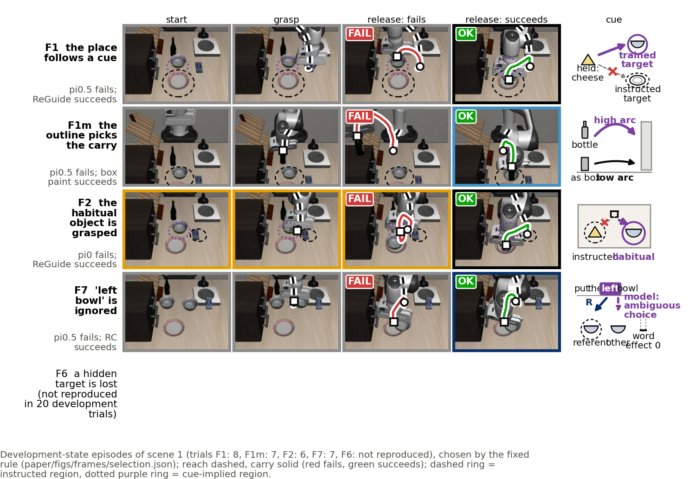
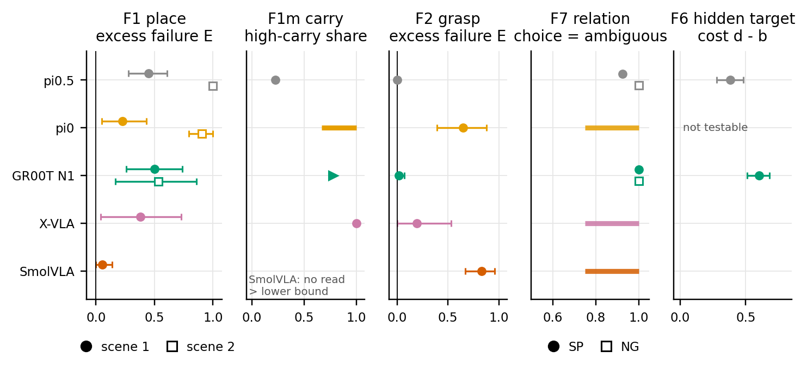
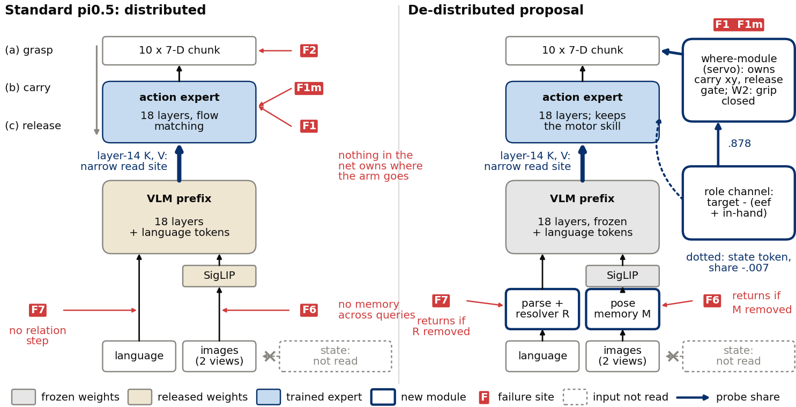

# Routed by Cues: Behaviour-Cloned Action Experts Do Not Take Up Explicit Geometry

<!-- Title alternatives:
1. Routed by Cues: Why a Learned VLA Cannot Own Where the Object Goes
2. Cues Choose the Sub-Goal, and Training Does Not Teach the Expert to Read the Target: An Analysis of Vision-Language-Action Models
-->

Bibliography: paper/refs.bib

Draft of 2026-11-22, reframed as an analysis paper (review: docs/notes/novelty_review_adv.md; previous draft: docs/history/DRAFT_2026-11-22_pre_reframe.md). The main text targets 8 ICML pages; the appendix follows the "# Appendix" heading and keeps the detailed results, the ledger pointers (SR = docs/SCAFFOLD_RESULTS.md, AF = docs/ARCH_FAILURES.md) and the registered verdicts. Prose follows the diffusion-composition paper's style rules: active voice, one idea per paragraph, no hedged contrasts. Held-out state sets 1, 2 and 3 are SR 87, SR 90 and SR 91.

## Abstract

Vision-language-action models (VLAs) succeed on trained tasks and fail when a new instruction pairs a known object with a known target. We ask where the knowledge of where the object goes can live. Across five VLAs, the action expert picks its sub-goal from visual cues that covaried with the role in training, and the instruction's roles do not pick it. We then hand a behaviour-cloned expert the exact target geometry in four ways (text, a continuous state token, a target crop, a counterfactual relabel) and measure by causal patching how much its behaviour depends on it. With a servo term kept in the loop, the learned where-share is -.007 with no added data and with a large planner dose alike. With the servo removed, it is -.001 without a relabel, .274 [.239, .314] for a small relabel and .124 [.089, .164] for a large planner dose, against a pass bar of .70. Explicit modules that own the where make the geometry effective: one inside the serving loop of a retrained policy and one outside the policy converge at .89 to .92 on held-out pairings. A matched-data ladder, a moved-plate test and a module-removal test complete the study. All results come from LIBERO, with one training seed per policy and several privileged perception inputs.

## 1 Introduction

A household robot that stacks a cup on a plate and a bowl on a shelf should also put the cup on the shelf. Instructions combine a small set of objects and targets in many ways, and a trained policy sees few of those combinations. Vision-language-action models (VLAs) reach .98 to 1.00 success on the tasks they trained on and fail on new pairings of the same objects and targets (CRAFT 2610.00524, LIBERO-PRO 2510.03827, LIBERO-CF 2602.17659).

The diagnosis is well established. A VLA keeps its local manipulation skill and loses the global grounding of the instruction. Correcting WHERE, Preserving HOW (ReGuide, 2609.38616) states this division of labour in its title and shows that a training-free wrapper that rebinds the referent and steers the arm to a demonstration-supported configuration lifts several backbones. Encoded but Not in Control (2610.06235) finds that the instruction's target is linearly decodable and goes unused. We take the diagnosis as established and ask what it implies for where the knowledge of the target position can be stored. If a behaviour-cloned action expert could learn to read exact target geometry when we hand it over, the repair would be a training recipe. If it cannot, the where must be owned by a component outside the learned network.

Behaviour cloning gives a reason to expect the second answer. In the trained tasks, the role phrase, the painted views and the held object already determine the target, so nothing in the imitation loss rewards reading an extra geometry input. This is the causal-confusion pattern of de Haan et al. (NeurIPS 2019): a cloned policy attends to the input that best predicts the expert's actions in the training distribution and ignores the one that carries the cause. We test the pattern in a large pretrained action expert with a causal measure of uptake, and we do so at matched data.

**What we find.** The analysis proceeds in six steps, and the order is the order of the evidence.

1. The failure atlas. On five frozen VLAs, sub-goals follow cues, and a same-state reference planner succeeds where the VLAs fail (Section 4). We cite CRAFT, ReGuide and Encoded but Not in Control as the established diagnosis and add the cue law and the five-model coverage.
2. The matched-data ladder. A role channel lifts a retrain by +.267 [+.092, +.467] over role views alone, and the channel helps only on top of restricted input (Section 5).
3. The dose-by-servo grid, which carries the central result. Four ways of handing the expert exact geometry leave its learned where-share at or near zero, unless the servo is off and the data demand the signal. Even then the share stays at .274 (Section 6).
4. Corroboration. An explicit where-module inside the serving loop (W5) and an external one (ReGuide) agree at .89 to .92, and no learned route reaches that value (Section 7).
5. The moved plate. Frozen pi0.5 follows a moved plate and narrow retrains acquire the position bias (Section 8).
6. Separable parts. The modules we built carry one failure each, and removing one returns exactly that failure on three held-out state sets (Section 9).

**Contributions.**
1. An analysis of why a behaviour-cloned VLA expert cannot own where the object goes: four ways of supplying exact target geometry, measured by causal patching at matched data, with a dose-by-servo grid that locates when the expert reads the signal.
2. A failure atlas on five frozen VLAs with a same-state planner and an excess-over-partners measure, and a pre-registered cue law for one scene.
3. A moved-plate result that separates the frozen model from its narrow retrains, in tension with the reading that VLAs bind absolute coordinates.
4. A separable modular decomposition (resolver, pose memory, where-module) with a registered module-removal test on three held-out state sets. We present it as a property of a system we built. It carries no claim about where the failures sit inside a VLA.

**Scope.** All results come from LIBERO, two scenes (a kitchen scene with 11 tasks and a living-room scene with one trained task) and pick-place tasks. Each trained policy has one seed. We list the privileged inputs in Section 10.

## 2 Related work

**Diagnosing held-out pairings.** LIBERO-PRO, LIBERO-CF and LIBERO-Plus (2510.13626) show collapse under perturbed objects and instructions. Robust Skills, Brittle Grounding (2602.24143) separates intact skills from brittle target selection on held-out object-location pairings. CRAFT reports 8.4%, 2.8% and 1.1% on held-out pairings for pi0.5, pi0 and GR00T after plain fine-tuning. Nouns, Not Modifiers (ICML 2026) reports that OpenVLA parses object nouns and fails spatial modifiers. Encoded but Not in Control reports attention-level evidence that the target is encoded and unused. We reproduce the routing result with behavioural tests on five models and add a reference planner on the same states.

**Where and how.** ReGuide owns the framing of this paper's thesis: it corrects where the arm goes with grounded poses and hands the frozen policy back control, so the policy keeps how to move. Our delta fits in one sentence: ReGuide shows that an external where-correction works, and we show why a learned action expert does not absorb one and that an explicit module inside a retrained policy converges to the same success. Other fixes retrain (CRAFT, ACT-VLA 2607.00351, AC-VLA 2607.15714) or edit a frozen policy (LiLo-VLA 2602.21531, Harness VLA 2607.08448, VP-VLA 2603.22003). w2VLA (2606.21496) splits the instruction into a skill string and an object string at the architecture level. We read w2VLA by abstract only (TODO(read in full)).

**Object-centric and role-addressed architectures.** TAX-Pose (2211.09325), SPOT (2411.00965), FOCI (2609.08743), OA-WAM (2605.06481) and POT-VLA (2607.18016) place actions in object-relative frames or feed role-indexed records to an action expert. Our role channel combines an input restriction with one such channel, and we claim no priority for any component.

**Mechanisms and shortcuts.** Grant et al. (2603.19233) inject activations at action-expert layers and redirect pi0.5 in 99.6% of 1,968 episodes, and read the motor program as bound to absolute workspace coordinates (TODO(verify): an ICLR 2026 version may report different transfer numbers). Wulff and Cangelosi (2610.10178) apply activation and attribution patching to the action-generation modules of pi0.5 and GR00T N1.7 and find sensitivity spread across early layers and some later ones. We use patching as a measure of uptake of a given input and make no claim about where language binds. De Haan et al. (2019) describe causal confusion in imitation learning, and the copycat and shortcut literature extends it; we position the grid of Section 6 as an instance in a large pretrained action expert. A recent audit (2606.04233, "What Are We Actually Benchmarking in Robot Manipulation?") finds that a small DINOv2 probe with no language encoder scores at or near the best reported results on LIBERO, which makes shortcut-prone benchmarks a live concern for our setting.

**Prediction of failure.** The appendix reports a steerability predictor (Okawa et al. 2310.09336 give the product form). It failed its registered test and sits in the appendix.

## 3 Setting and measures

**Models and scenes.** We test five frozen VLAs trained on LIBERO's 40 tasks: pi0.5, pi0, GR00T N1, X-VLA and SmolVLA. We never retrain them in the atlas. Scene 1 descends from LIBERO-Goal's kitchen and has five trained tasks (K1-K4, K6) and six held-out pairings (N1-N6). Scene 2 is LIBERO-10's living-room scene with two mugs and two plates and one trained task. A role is the object role or the target role of an instruction. A held-out pairing combines an object role from one trained task with a target role from another. Its known partners are the trained tasks that share its object and its target. A cue is any visual feature that covaried with a sub-goal in training.

**Excess failure.** For a held-out pairing, the excess failure E is the failure rate of the pairing minus the failure rate of its known partners, so E isolates the pairing from the difficulty of the object or the target.

**Reference planner.** A scripted planner on the same states reads simulator state. It reaches .894 on the held-out pairings of scene 1.

**Learned where-share.** The central measure of this paper is the learned where-share. We replay recorded model inputs open loop, and we patch the where-input (the state token, or token plus crop) from a counterfactual run, in which the target is shifted, into the original run. The where-share is the fraction of the counterfactual effect on the output chunk that this patch recovers. A share near zero means the network's behaviour does not depend on the input. A route passes when the lower bound of the pooled share is at least .70 and fails when the upper bound is under .30.

**Statistics.** Each confirmatory test has a pre-registered ledger row that fixes arms, states, predictions and decision rules before any main rollout. We compute every contrast by a paired bootstrap that resamples tasks and states jointly, with 2,000 draws, and report 95% intervals. Held-out state sets are start states that no earlier experiment used and that we draw by fixed rules before any rollout. The atlas and the cue reads on development states were development reads, and we mark them as such.

## 4 Cues route the sub-goal

This section establishes the diagnosis that the later sections build on. We keep it short, because the diagnosis is known, and we add three things: coverage over five models with a reference planner, a cue law, and an excess-over-partners measure.

**Five failures, five models.** After a correct grasp, the carry and release follow a cue and ignore the instruction's target role (F1). The excess failure on held-out states of scene 1 is +.450 [.28, .61] for pi0.5, +.225 [.05, .43] for pi0, +.500 [.26, .74] for GR00T and +.379 [.04, .73] for X-VLA. SmolVLA shows no break there (+.054 [-.00, .14]) because it already fails inside the chunk at the grasp. The held object's outline starts the carry (F1m). The habitual object is grasped (F2), with a grasp excess of +.650 [.39, .88] on pi0 and +.833 [.67, .96] on SmolVLA. Relational and negated language leaves the choice of referent unchanged (F7): on pi0.5 and GR00T the relational choice equals the ambiguous choice on 92.5 to 100% of states. A covered target costs placement precision in pi0.5 and the target's location in GR00T (F6). The reference planner succeeds on the same states in each case where we claim a break. A fifth item, the new-layout failure, fails the planners too and carries no claim about VLAs (Appendix B).

**A cue law in scene 2.** In scene 2, every model scores 0 of 720 episodes on the two held-out pairings, while pi0.5 scores .99 on the trained halves. A series of reads on pi0.5 identifies the cue that picks the plate. A pre-registered test on new layouts confirms a majority rule: the place goes to the plate backed by two of three cues (nearer, more salient, trained), on .912 [.883, .942] of 445 placements in which the cues disagree. The trained plate is outvoted on 153 of 153 placements, and the instruction is unresolved in every run. The rule holds on pi0.5 only.

**Edits to the input remove only cues the task does not need.** Role views plus role phrases lift pi0.5 from .450 to .817 on held-out pairings of scene 1, with the trained tasks at -.010 [-.08, +.04]. The same views give .000 in scene 2, where the cue is position and the grasp needs it. The behavioural evidence says which cue wins. It cannot say where in the network the choice is made, and Section 9 does not claim to.

**What the atlas leaves to the next section.** If the expert follows cues and ignores roles, a repair must give it the target's geometry. Section 5 builds that repair at matched data, and Section 6 asks whether the expert reads what it is given.

## 5 A role channel at matched data

We first train the binding into a policy on the same demonstrations as a plain retrain, and we test whether it closes the place gap. A ladder of retrains on LIBERO-Goal's eight known tasks uses the same 52,181 frames, the frozen VLM, the same action expert, 6,001 steps and one seed. R0 retrains the action expert on whole instructions and frames. R2 restricts the input to the active role's entity, with role phrases and painted views. Rrel is R0 plus the role channel, and RAA is R2 plus it. The channel is one input, the position of the active role entity relative to the gripper, in whole centimetres, with a role id. It enters as a short text suffix on the prompt, because the served pi0.5 reads no state input. At test time, learned masks and an estimator with rendered depth and calibration locate the entity.

**Table 1.** Matched-data results on 60 states per task in scene 1. RAA-s adds a fixed servo residual on the translation dimensions of each chunk to RAA. RAA-sL starts RAA-s from the LIBERO-fine-tuned pi0.5, and the other retrains start from the base weights. ReGuide (rgp) is the external reference.

| variant | N1-N6 | right grasp | placed given right grasp | K1-K6 |
|---|---|---|---|---|
| R0 | .042 | .417 | .100 | .853 |
| R2 | .389 | .972 | .400 | .753 |
| Rrel | .278 | .861 | .323 | .911 |
| RAA | .656 | 1.000 | .656 | .839 |
| RAA-s | .717 | .967 | .741 | .844 |
| RAA-sL | .878 | .997 | .880 | .936 |
| rgp (ReGuide) | .897 | .989 | .907 | .950 |

**Input purity repairs the grasp and the channel repairs part of the place.** R2 fixes the grasp (right-grasp rate .972) and places only .400 of those right grasps. RAA beats R2 on held-out pairings by +.267 [+.092, +.467], and its right-grasp rate rises by only .028, so the place step supplies almost all of the gain. The trained tasks stay level (+.086 [+.011, +.172]). The channel needs pure input: Rrel gains +.236 [-.006, +.553] over R0, and RAA beats Rrel by +.378 [+.133, +.658]. This is the cleanest controlled result of the study, and its only comparator is a plain retrain at the same data.

**The remaining gap sits at the release, and format does not close it.** In 47 of 51 failures, RAA carries the right object to the right target and lets go outside LIBERO's placement tolerance, with misses of 3.7 to 7.9 cm against ReGuide's median of 0.9 to 1.7 cm. Measuring the target from the held object instead of the gripper (RAA-o) removes the dependence of the release error on the in-hand offset and does not raise success (-.061 [-.264, +.108]). Feeding the same offset as a continuous state token through one new linear layer of 33,792 parameters (RAA-c) lowers success to .503, with no clear difference from RAA-o (-.092 [-.306, +.072]), even though the token reaches the model intact (median error .94 cm). A fixed servo term (RAA-s) lifts success to .717, and starting from the broader LIBERO-fine-tuned initialisation (RAA-sL) gives .878. The jump from RAA-s to RAA-sL is not clearly supported (+.161 [-.017, +.311]), so we attribute part of it to the initialisation. Every retrain with the exact offset as numbers or text leaves a gap of centimetres. The question that follows is whether the network reads the number at all.

## 6 The dose-by-servo grid: when does the expert read the where-input?

This section carries the central result. In RAA-sL, patching the servo input and the state token together accounts for .871 [.834, .914] of the total effect, and the servo alone carries .878. The state token carries -.007, so the trained expert does not read the token's value. We hypothesise a behaviour-cloning shortcut: in the trained tasks the role phrase, the painted views and the held object already determine the target, so nothing in the loss rewards reading the token. A learned network then uses a where-signal only as far as the training data force it to, and only if no other path supplies the correction. Four data routes test the hypothesis, with one selection rule fixed before any run (Section 3).

**Routes.** Route A relabels held-phase demonstration frames with a counterfactual goal offset that stays in the support of the demonstrations (1 to 9 cm), on a model without the servo, so the labels carry the shift and only the token can supply it. Route A0 is the same servo-free model on the base data with no relabel, and it is the matched comparator. Route B adds a crop of the target as an extra image input and leaves the labels unchanged, so it has no data dose. Route A+ adds planner demonstrations with shifts of 19 to 38 cm, which the prompt and the views do not determine, and keeps the servo. Route A+0 is A+ with the servo removed; we added it after we had seen A+'s probe, so it is a post hoc route. A control that trains on the same planner data with no token and no servo shows that the planner data alone do not supply the where-skill: it falls below RAA-sL on held-out pairings by -.247 [-.483, -.030].

**Table 2.** The learned where-share by data dose and servo (96 observations per route on development states, clustered bootstrap, 95% intervals). The pass bar is .70.

| dose | servo | route | learned where-share |
|---|---|---|---|
| none | kept | RAA-sL | -.007 [-.008, -.006] |
| none | off | A0 | -.001 [-.001, .000] |
| none, target crop | off | B | .022 [-.046, .089] |
| small (relabel, 1-9 cm) | off | A | .274 [.239, .314] |
| large (planner, 19-38 cm) | kept | A+ | -.007 [-.013, -.000] |
| large (planner, 19-38 cm) | off | A+0 (post hoc) | .124 [.089, .164] |

**The network reads the where-input only when the servo is off and the data demand it.** With no data dose the share is zero (A0 and B). The relabel raises it by +.272 [+.238, +.312] over A0, to .426 [.352, .512] on the held-out set and .170 [.141, .203] on the trained set. The crop adds nothing detectable (+.030 [-.034, +.089]). With the servo kept, even planner shifts of 19 to 38 cm leave the share at the reference value (A+ -.007). The servo accounts for that zero: A+0 reads .124, which is +.133 [.096, .171] above A+. The state-projection layer moved about equally in A+ and A+0 (7.2% against 8.5% input-dimension change on dx) and stayed near its random initialisation in RAA-sL, A0 and B (an exploratory check, Appendix E), which points to the servo rather than an untrained layer as the cause of A+'s null share. The large dose without the servo does not do better than the small relabel (A+0 minus A is -.150 [-.196, -.104]). No route reaches the .70 bar, no route is eligible, and the fifth held-out state set stays sealed.

**Behaviour agrees.** No servo-free route recovers RAA-sL's release aim on held-out pairings: A is -.100 [-.261, +.050] below it, B -.233 [-.447, -.019] and A0 -.192 [-.406, +.019]. A+0 reaches .603 on held-out pairings against .878 for RAA-sL. Details are in Appendix E.

**Reading.** The exact geometry is present in the input and the labels, and a behaviour-cloned expert uses it to the extent that no other path supplies the correction and the data require it. Even then it uses about a quarter of it. This is the case for a where-module outside the learned network: the signal such a module carries does not arrive in the expert through a loss that does not need it. The case has limits that we state in Section 10: one seed per route, one checkpoint, and the served pi0.5 reads no state, so the token enters through a new layer trained for 6,000 steps with the VLM frozen. Whether pi0, which reads state natively, behaves the same way is the replication we plan (TODO(pending): a token-only oracle arm and a pi0 replication, docs/notes/plan_oracle_pi0.md).

## 7 Two explicit where-modules converge

If the expert does not take up the geometry, a module must own it. We give a module sole ownership of the target-directed motion of the same RAA-sL checkpoint at serving time and train nothing. The module owns where the object goes and when it is let go, and the expert keeps how to move: the lift, the approach, the final alignment and the gripper. Getting the boundary right took six variants, W1 to W6, which we tabulate in Appendix C. Three findings from that history shape the design. Owning the xy of the whole carry recovers the covered target and costs the trained tasks with elevated targets (K1-K6 falls from .936 to .528). The module must aim at the release point that the demonstrations show for the target's class, not at the target's reference point (the rack's reference lies 12.5 cm in xy from where demonstrations release the object). The module must hand the last 3 cm back to the expert, because its estimate of the held object is coarser than the success tolerance. The final design, W5, applies both corrections and uses a hand-set gain, clearance, hand-off radius and per-class release table.

**W5 and ReGuide agree.** On the first held-out state set, W5 reaches .892 on held-out pairings against .914 for ReGuide with perceived poses (-.022 [-.114, +.047]). In a registered replication on a further set with no code change, W5 reaches .894 against .917 (-.022 [-.147, +.069]). Neither test shows non-inferiority at the margin of -.10, because the lower bounds fall below it. A pooled secondary analysis over three sets puts the difference at +.001 [-.053, +.049], and we saw two of those three sets before we registered the analysis, so the pooled value supports a statement about the point estimate only. A variant that tried to repair W5's weaknesses (W6) lost to it (.764 against .931 on a third set). We read the near-identical success of two systems that share nothing but the explicit where as corroboration: a where-module inside the loop of a retrained policy and a where-correction outside a frozen policy reach one value, and no learned route in Section 6 reaches it.

**Where the agreement comes from and where it ends.** The two systems differ elsewhere. W5 beats ReGuide on relational language (F7 pool .750 against .375) and on the covered plate relative to RAA-sL (.817 against .050 on the third set), because ReGuide has no resolver and no memory. We expect that a template parser added to ReGuide would remove the F7 margin, and we have not run that arm (TODO(pending)). W5's unique-name controls stay below RAA-sL (-.106 [-.156, -.050] on the third set), and its weakest cell, N4, sits below ReGuide on two of three sets. The servo is hand-set, and a target class absent from the demonstrations cannot be aimed.

## 8 A moved plate: frozen pi0.5 follows it, narrow retrains do not

If the expert held trained coordinates, a moved target would expose them. We test the simpler reading, in which a VLA learns an object's trained coordinates and the arm goes there when the target moves, in scene 1 on K1 ("put the bowl on the plate", plate movable) and K2 (stove fixed). The demonstrations place the plate within .027 m of one centre, and we move it .141 to .296 m away (far), which is 5 to 11 times the demonstration range, with 40 states per cell. Four systems run on the same states: frozen pi0.5, the narrow retrain R2, RAA and ReGuide with perceived poses. A release counts as trained when it lies more than 3 cm closer to the trained plate position than to the actual plate.

**Result.** Frozen pi0.5 succeeds on .975 [.925, 1.000] of the far-plate states and releases at the trained position on 0 of 40, with a median release 2.0 cm from the actual plate. R2 behaves as the position account says: on the far plate it releases at the trained position on 31 of 40 episodes (.775 [.625, .900]), with a median 20.2 cm from the actual plate, and succeeds on 0 of 40. RAA neither releases at the trained position (.025) nor reaches the moved plate (.100 success), so RAA minus frozen pi0.5 is -.875 [-.975, -.750]. The architecture we propose is therefore less robust here than the frozen model it repairs.

**Reading.** The broad pretrained model does not carry the position bias, and narrow fine-tuning on the eight known tasks induces it. This sits in tension with the reading that the expert's motor program is bound to absolute workspace coordinates (Grant et al., TODO(verify version)): for the frozen model on this plate, the program follows the plate. The result also agrees with the nearer-plate cue of Section 4, where the cue is a feature of the scene. The test has one scene, two tasks, one seed per state and one checkpoint per retrain, and the R2 result is descriptive and not registered. With the bowl .14 to .30 m away, frozen pi0.5 succeeds on only .375 [.225, .525] of K1 states, and the weakness sits in the grasp (Appendix F).

## 9 A separable modular decomposition

The modules we built carry one failure each. We state the claim as a property of the decomposition and make no claim about where failures sit inside a VLA. The resolver R turns a relational instruction such as "the bowl on the left" into one entity and serves F7. The pose memory M keeps the last estimate of an entity that a cover hides or a view loses and serves F6 in the RAA models. The where-module serves F1 and F1m. Figure 4 shows the decomposition.

**Registered module-removal test.** We run three arms on the same states, with RAA-sL-W5 as the policy: full, no resolver (largest-component rule) and no memory (the channel suffix is omitted whenever its estimate is held). The contrasts are the gain of the resolver on the relational cells, the gain of the memory on the covered-plate cell, the two cross terms, and the trained tasks. A contrast is testable when the full policy scores at least .70 on the trained tasks and at least .50 on the unhidden control of its cell. We fixed the design and the state-drawing rules before any rollout, on held-out state sets that no earlier experiment used, because the module itself had been revised on the earlier states.

**Table 3.** Effect of removing one module (drop in success, 95% intervals, 60 states per cell, one seed) on three held-out state sets. Set 2 runs the module variant W6. Every gate is testable on all three sets.

| held-out state set | remove resolver (relational cells) | remove memory (covered plate) |
|---|---|---|
| 1 | +.483 [+.425, +.538] | +.217 [+.033, +.383] |
| 2 (W6) | +.504 [+.454, +.554] | +.400 [+.267, +.550] |
| 3 | +.408 [+.350, +.463] | +.367 [+.217, +.517] |

**Reading, with the caveats the design requires.** Removing the resolver restores the relational failure, and removing the memory restores the hidden-target failure, and neither removal moves the other cell (cross terms within an equivalence bound on all three sets). Three caveats limit what this shows. First, the cross terms for the resolver hold by construction: the resolver does not engage on the covered-plate cell or on the trained tasks, so those cells are identical on all 60 states (0 [0, 0]). The memory cross term is a measurement (-.054 [-.100, -.012], -.033 [-.075, +.008] and -.008 [-.046, +.029]). Second, the modules exist to repair these failures, so their removal restoring them verifies that they work as built. Third, the covered-plate failure of the RAA models is partly a failure our channel and servo design induced: RAA-sL scores .017 on the covered plate and frozen pi0.5 scores .517. On frozen pi0.5 the covered plate costs placement precision at LIBERO's 3 cm tolerance (44 of its 50 failures release within 3 cm of the plate centre), because the cover marks the plate's position. The memory result is therefore a location-memory result in the RAA models and says nothing about memory in frozen pi0.5. We also ran an in-network version of the localisation question (activation patching on frozen pi0.5, Appendix D). It finds the effect written across many layers and read at a narrow site (the layer-14 keys and values), and it finds neither a localised nor a selective band, so we report it as a negative result.

A second scene replicates the direction of the resolver removal with a privileged where channel (+.433 [+.358, +.517]) and leaves the memory half untestable (Appendix C).

## 10 Limitations

**Privileged inputs.** The fixes need depth and calibration: the estimator that locates entities uses rendered depth and calibration, and ReGuide's perceived-pose runs use the same perception. Scene-2 role views use simulator masks. The F7 resolver is a fixed-template rule on a parsed scene and carries no language-understanding claim. The scene-2 where channel is privileged, with a channel error of 0 by construction. The reference planners use simulator state or privileged depth and calibration. A calibrated RGB-D sensor would supply these inputs, and an RGB-only policy would not.

**Baselines and comparability.** Our ReGuide is a reimplementation from its paper with our segmenter, and it omits ReGuide's post-hand-back escort. We ran no arms on the CRAFT, ACT-VLA or AC-VLA splits, so our numbers are not directly comparable with their published values. Those methods reach comparable or higher success with data or training fixes and without privileged depth.

**Statistics and scale.** Every trained policy has one seed. A second training seed of RAA-sL is running (TODO(pending)), and a token-only oracle arm and a pi0 replication are planned (TODO(pending), docs/notes/plan_oracle_pi0.md). Intervals resample six tasks. The token enters the served pi0.5 through a new layer, which leaves open that under-training explains part of the zero share. The designs W1 to W5 came from diagnoses on the states of the development reads, and the held-out state sets are the reads free of that selection. The registered tests apply no multiplicity correction. The atlas runs mostly on development states, and only F1 and F2 replicate on held-out states. All results come from one simulator and pick-place tasks.

**Strengths.** The study pre-registers its confirmatory reads, draws held-out state sets by fixed rules, uses paired clustered bootstrap intervals, and reports its failed routes (the learned routes of Section 6, W6, the predictor). These practices address the significance and shortcut concerns of the benchmark audit 2606.04233, which finds that a small DINOv2 probe nearly solves LIBERO.

## 11 Conclusion

A behaviour-cloned VLA expert uses exact target geometry only to the extent that no other path supplies the correction and the data require it, and at the doses we tested it uses about a quarter. Explicit modules that own the where, one inside a retrained policy and one outside a frozen one, reach the same success, and we build the one inside as a separable decomposition whose parts carry one failure each. These results come from one simulator, one backbone and one seed per policy, and the planned replications on a second seed, a token-only oracle and pi0 decide how far the central claim extends.

---

# Appendix

This part holds every result removed from the main text. SR numbers point to docs/SCAFFOLD_RESULTS.md, AF to docs/ARCH_FAILURES.md, and verdict words are the registered ones. The earlier draft with the full prose of every subsection is docs/history/DRAFT_2026-11-22_pre_reframe.md; sections here condense it and keep every number.

## A Setting details

**Models.** pi0.5 (openpi pi05_libero), pi0 (pi0_libero), GR00T N1 (ar0s/groot_libero), X-VLA (xvla-libero), SmolVLA (smolvla_libero) (SR §50, §65). X-VLA enters the atlas and the F7 reads and misses the transport reads, because its server sends absolute end-effector targets and our ReGuide transports issue delta commands.

**Scenes.** Scene 1 has 11 tasks (SR §55): K1-K4 and K6, and N1-N6 (cheese or wine bottle with plate, stove, cabinet or bowl). It has two layouts, one with the trained start regions and one that shifts them. Scene 2 is LIBERO-10's LIVING_ROOM_SCENE5 (white mug, yellow-and-white mug, red mug, left plate, right plate); its trained task puts the white mug on the left plate and the yellow-and-white mug on the right plate. In scene 2, K1 and K2 are the two halves of the compound, and N1 and N2 re-pair the mugs and plates. The testability floor says a model is testable on a scene only if it scores at least .70 on the trained tasks; scene-2 GR00T scores .508 [.333, .667].

**States.** Scene 1 uses 20 development states, 20 further states and blocks of 40 to 60 states (SR §47, §65, §71). Scene 2 uses 60 (SR §50).

**Reference planner.** U scores .894 on held-out pairings of scene 1 from simulator poses, .883 from camera poses and .881 from a learned segmenter (SR §38.1, §40.1). In scene 2 it scores .967 on N2 and .333 on N1, pooling to .65 [.25, 1.00] (SR §50).

**Criteria for architecture-rooted failures.** C1: the input holds the needed information and the reference planner reaches .80. C2: the failure persists across models (models, chunk length, prompting; no data ladder). C3: a structural change that adds no information removes the failure. A failure that misses C1 belongs to the task. We phrase C3 as "adds no task information beyond a calibrated RGB-D sensor".

**Registration.** Each confirmatory read has a ledger row (m3_prereg) written before any main rollout. Verdicts appear in capitals (SUPPORTED, NOT SUPPORTED, NOT SHOWN, REVERSED, PARTIAL, EQUIVALENT, NON-INFERIOR, UNTESTABLE).

## B The failure atlas in detail

**Table B1.** Measured break by failure and model. E is the excess failure over known partners.

| failure | pi0.5 | pi0 | GR00T N1 | X-VLA | SmolVLA |
|---|---|---|---|---|---|
| F1, scene 1, cross-chunk E, held-out states | +.450 [.28, .61] | +.225 [.05, .43] | +.500 [.26, .74] | +.379 [.04, .73] | +.054 [-.00, .14], no break |
| F1, scene 2, cross-chunk E (SR §50) | +1.000 [1.00, 1.00] | +.908 [.792, 1.00] | +.533 [.167, .858], below floor | | |
| F1m, N4 and N6 (SR §51) | succeeds .04 after a high carry, .66 after a low one | high carry on .67-1.00 of grasps | high carry on at least .78 | high carry on 1.00 | |
| F2, grasp E, held-out states | +.000 [.00, .00] | +.650 [.39, .88] | +.017 [.00, .07] | +.192 [.00, .53] | +.833 [.67, .96] |
| F7, relational choice equals ambiguous choice (SR §45.1, §45.3) | .925 (SP), 1.00 (NG) | ignored on 4 of 6 cells across pi0, X-VLA, SmolVLA, agreement 75-100% | 1.00 (SP), 1.00 (NG, PARTIAL) | see pi0 | see pi0 |
| F6, cost of covering the plate, d - b (SR §45.6, f6_diag) | .38 [.28, .48] | not testable, gate .017 | .60 [.51, .68] | | |
| New layout | NEITHER | NEITHER | NEITHER | NEITHER | NEITHER |

**F1.** Trained tasks run at .98-1.00 on pi0.5 and GR00T in scene 1 (AF §3). SmolVLA fails inside the chunk (within-chunk E +.862 [.73, .96]). The four cross-chunk verdicts replicate from development to held-out states. In scene 2 every model scores 0 of 720 on the two held-out pairings while pi0.5 scores .99 and pi0 .81 on the trained halves; the swapped two-step task scores 0 of 180 and ends in the trained arrangement on .83-.98. Chunk lengths of 2 and 10 change pi0.5 by -.050 [-.250, +.150] and -.042 [-.200, +.100] and GR00T by -.008 [-.117, +.100] and +.083 [-.025, +.233] (SR §32.1). The scene-2 cue series on pi0.5: with the mugs' start positions swapped, 287 of 287 placements go to the start-side plate (SR §57); pi0 gives .993 of 145 (SR §58); with the plates moved, 0 of 116 and 0 of 125 disagreeing placements go to the start-side plate (SR §59); with the nearer plate the less salient one, 158 of 158 placements go to the small nearer plate when it is the trained one, and .859 of 149 to the large far plate when that is the trained one (SR §60). Majority rule (SR §61): trained plate outvoted 153 of 153, salient plate .974 of 151, nearer plate .752 [.660, .843] of 141; earlier layouts replicate at .970 of 427. The planner meets C1 on three layouts (.825-.838) and misses it on three (.725-.788). Fixes: the front end tvpb lifts pi0.5 from .454 to .938 with no trained-task cost (SR §55). The hand-over to a parts policy lifts GR00T from .17 to .84 and pi0.5 from .50 to .85 [+.017, +.675] (NOT SHOWN for pi0.5, SR §44.1). In scene 2 a reimplemented ReGuide lifts pi0.5 to .708 [.650, .775] on N1+N2 and pi0 to .700 (SR §68). The majority rule holds on pi0.5 only; pi0's labels are unresolved on two layouts, and GR00T matches nearer-plate routing below its floor. Grant et al. hold the attention-path probe.

**F1m.** The planner P_min scores .80 on N4 and .80 on N6. From a pre-grasped pose 6 cm above the target the servo scores 25 of 26 and a bare release 21 of 26; with the bottle held above the target pi0.5 places 26 of 26 (SR §51). Painting the held bottle as its box lowers the high-carry share from .225 to .062 and raises N4+N6 from .625 to .812 (+.188 [+.075, +.325]) with no known-task cost (SR §53). On GR00T the same box adds +.025 [-.025, +.100] (UNRESOLVED) at -.070 on trained tasks (SR §56). ReGuide's transport takes GR00T's N4 high-carry share from 1.00 to 0 of 38; N6 still carries high on .821 and reaches .200 (SR §71). GR00T's N6 places 0 of 14 even from above the bowl. The cue is the outline on pi0.5 and does not transfer.

**F2.** Frozen pi0.5 and GR00T grasp the named object at .950-.992 (SR §32.1). On pi0 and SmolVLA .679 and .829 of held-out episodes end at the grasp (SR §65). In scene 2, pi0.5 puts back a held mug the instruction does not name and grasps it again 240 of 240 times (SR §64); after a clear-away carry it takes the named mug on .167 of N2 episodes and after its trained white-mug carry on .967 (SR §67). ReGuide's approach transport lifts pi0 from .021 to .608 and SmolVLA from .021 to .604, with trained tasks at +.020 [.000, +.060] and +.030 [-.020, +.120] (SR §65); in scene 2 it moves pi0.5's first hold to the named mug on 60 of 60 N2 episodes against 0 for the hand-over alone (SR §68). Role views alone lift pi0 by +.183 [+.021, +.412] and do nothing on SmolVLA.

**F7.** With two identical bowls, only the relation picks the referent. With the other bowl removed the models score .825-1.00 and the scripted references .93-1.00 (SR §45.1). Referent share is .475-.50. On pi0, X-VLA and SmolVLA the relation is ignored on 4 of 6 cells; X-VLA and SmolVLA on SP have no power (SR §45.3); F7 holds on all five VLAs on at least one family. A negated LIBERO-PRO instruction scores 0 of 20 on pi0.5 and GR00T against .95 for the trained one (descriptive). A resolver plus a role view paints the other bowl: it fixes 3 of 4 cells with the resolver exact on 160 of 160; pi0.5 goes from .40 to 1.00 (SP) and .20 to .775 (NG), GR00T SP from .30 to .85 (SR §45.2). On pi0, X-VLA and SmolVLA it fixes 0 of 6 cells (resolver exact 240 of 240), because those models fail even the named plate bowl on 0 of 20. GR00T's NG cell is capped at .50 by its unique-name control. Wulff and Cangelosi find strong directional-language sensitivity in pi0.5 and GR00T, which conflicts with the .004 chunk change we measure for a left-right swap in Appendix D (TODO(reconcile)).

**F6.** The plate appears displaced and a cylinder then covers it (a never, b after the first query, c from the start, d beside the plate). The planner reaches .839 on 120 states; d keeps pi0.5 at .967 and GR00T at .742. Covering costs pi0.5 .38 [.28, .48] and GR00T .60 [.51, .68]; b stays within .05 of c (+.05 [-.05, +.158] and +.042 [-.033, +.117]); PARTIAL on both models (equivalence bound missed by .058 and .017). A memory overlay raises pi0.5 from .58 to .84 (+.26 [+.15, +.35]) and GR00T from .14 to .28 (+.14 [+.04, +.24]). Failure-mode classification (f6_diag; opaque cylinder with collisions off; LIBERO's On(): bowl centre within 3 cm xy and in contact): of 50 failures of frozen pi0.5 under b (success .583, 120 states), 44 release within 3 cm of the centre (median 1.8 cm) and 6 release 3-10 cm away; the bowl slides about 2.6 cm and ends 4.05 cm from the centre against 2.07 for successes. c gives .533, about b; a gives .942, d .967, the overlay .842. GR00T's b failures release 3 cm or more away on 76%, ending about 21 cm away. The plate leaks into view on 32-49% of later queries; GR00T sits at the rule's boundary and the overlay trails d by -.458 [-.558, -.358]; pi0 is not testable (gate .017).

**New layout.** Success on N1-N6 is .30 on pi0.5 and .08 on GR00T; the scripted servo scores .31, P_min .37 and U .378; all fail on the same states; the demo's fixed top-down grasp holds on 0 of 10 cheese and 0 of 10 bottle states (AF §3). C1 fails, so this is a limit of the task.

**Fixes by group.** Input-only (SR §47-§56, §65-§67): role views plus phrases lift pi0.5 .450 to .817 (+.367 [+.092, +.634]) with trained tasks -.010 [-.08, +.04]; silhouettes beat a grey proxy by +.442 [+.208, +.675]; phrases alone add +.025 [-.15, +.19]; tvpb reaches .938 against .454; on GR00T views add +.186 [+.033, +.361]. In scene 2 views give .000 on pi0.5 and GR00T; before a hand-over they lift N1+N2 to .508 at -.108 [-.158, -.058] on trained tasks. On pi0 and SmolVLA tvpb costs trained tasks -.485 [-.725, -.220] and -.935 [-1.00, -.810]. Transport-level (ReGuide reimplementation): pi0.5 .929 against tvpb .938 (+.008 [-.083, +.092], EQUIVALENT); GR00T N1-N6 .212 to .838 (+.625 [+.350, +.879]); scene 2 N1+N2 .708 on pi0.5 and .700 on pi0, beating our hand-over by +.350 [+.242, +.458]; without rendered depth .700 [.633, .775] on pi0.5 and .608 on pi0. Our hand-over reaches .442 (simulator) and .450 (perception). Resolver and memory composite RC (SR §70): beats ReGuide alone on F7 by +.550 [+.488, +.625] (SP) and +.663 [+.587, +.738] (NG) with trained tasks -.008 [-.025, .000]; on F6 the slot lifts pi0.5 from .517 to .817 (+.300 [+.167, +.433]); RC beats ReGuide by +.167 [+.050, +.284]; ReGuide's pose registration shows no measured memory (+.117 [-.033, +.267]); on pi0 the composite beats ReGuide on SP by +.375 and costs K1t -.100 [-.183, -.033] (PARTIAL).

**N1 residual in scene 2.** N1 stays at .417-.500 under perceived poses and reaches .833-.900 under simulator poses (SR §68, §72). The rigid held-mug estimate sits 5.65 cm off at release; a box tracker leaves it at 5.71 cm (N1 +.133 [-.033, +.283], NO CLEAR DIFFERENCE; N2 fell by .583). Swapping the simulator's held-mug pose gives .567 against .500 (+.067 [-.067, +.200]), the target-plate pose .450 (-.050 [-.183, +.084]); the oracle variant reaches .900, +.333 [+.183, +.467] over the held-mug swap, which also switches the interaction rule. The reading of the hold and release events is untested.

## C The module-owned where and the removal test in detail

**Table C1.** The W1-W6 chronology (serving-time changes of the RAA-sL checkpoint, no retraining; SR §84-§91). Development states unless stated.

| variant | what the module owns | outcome |
|---|---|---|
| W1 | xy of every chunk row while the role is the target (saturating servo, gain 46.875/m, clip at 2 cm) | covered plate F6 .017 to .817; trained tasks -.408 [-.720, -.119] (K1-K6 .528); K3 .967 to 0, K5 .683 to 0 |
| W2 | W1 plus a closed-gripper command while the bowl is more than 2 cm from the target | F6 .900; K1-K6 .542; unique-name controls .458 fail their gate |
| W3 | xy only while the held object stands at least 3 cm above the target's reference height | K3 0 to .967, K4 .283 to .983, N3 .333 to .850; K1-K6 .814; N1-N6 .922; F6 .717; K5 .067 |
| W4 | W3 plus W2's release gate | N1-N6 .928 (non-inferior to ReGuide, +.025 [-.053, +.111]); K1-K6 .819; F6 .867; K5 .067; controls .467 |
| W5 | release-point aim C1 (servo input minus the class's median release offset mu) plus 3 cm hand-off C2 | held-out set 1: N1-N6 .892, K5 .950, covered plate .650; non-inferiority to ReGuide not shown |
| W6 | release envelope plus target latch | held-out set 2: N1-N6 .764 against .931 for W5 (-.167 [-.392, -.011]); cabinet-top N2 .317; latch a null (+.008 [-.028, +.061]) |

Diagnoses behind the steps: under W1 the held object has moved 3 cm sideways 4-5 steps after the lift and touches the elevated target while more than 5 cm away (K3 20 of 20; K5 16 of 20 stall); demonstrations begin xy transport at a median 7.5 cm below the target's reference height (SR §85). The rack's reference lies 12.5 cm in xy from where demonstrations release the object, against 0.9 (plate), 3.5 (stove) and 5.3 cm (cabinet) (SR §86). The module's held-object estimate has median error 0.95 cm and p90 2.8 cm; its open-loop 5-step chunks pass through the target in 45% of chunks starting 1-4 cm away against 11% for the expert; success falls from .983 to .438 as channel error grows from under 0.5 to at least 2.0 cm while RAA-sL goes from 1.000 to .867. mu table: plate (-0.47, -0.15) cm, bowl (+0.29, -0.03), stove (-3.31, -0.82), cabinet (+4.23, -3.23), rack (-8.94, +8.13).

**Table C2.** Cells on held-out state sets 1 / 2 / 3 (SR §87, §90, §91; 60 states per cell). W6 ran on set 2 only.

| cell | W5 | W6 (set 2) | RAA-sL | rgp |
|---|---|---|---|---|
| N1-N6 | .892 / .931 / .894 | .764 | .875 / .853 / .878 | .914 / .883 / .917 |
| N4 | .717 / .783 / .533 | .667 | .783 / .767 / .817 | .867 / .717 / .800 |
| N6 | .767 / .900 / .900 | .883 | .833 / .750 / .767 | .733 / .750 / .800 |
| K1-K6 | .947 / .964 / .936 | .947 | .939 / .939 / .944 | .958 / .972 / .942 |
| K5 (rack) | .950 / .967 / .950 | .833 | .650 / .667 / .767 | .817 / .883 / .733 |
| K6 | .833 / .900 / .867 | .883 | 1.000 / .967 / 1.000 | .983 / 1.000 / .983 |
| F6_b (covered plate) | .650 / .583 / .817 | .800 | .067 / .100 / .050 | .683 / .700 / .667 |

On set 1, the contrasts of W5 and its components: K5 .950 against .017 (W4) and .650 (RAA-sL, +.300 [+.200, +.417]); W5c1 alone .800, W5c2 alone .017, so C1 carries the rack. C2 recovers part of the controls (W5c2 minus W4 +.083 [+.028, +.144]; F7 pool +.058 [+.017, +.100]) at F6_b -.150 [-.267, -.033]. Controls stay below RAA-sL (-.094 [-.139, -.050]; left unique-name .683 against .933). On the covered plate W5 beats RAA-sL (+.583 [+.467, +.717]) and ties frozen pi0.5 (.650 against .667, -.017 [-.200, +.183]); on set 3 it beats it (+.317 [+.150, +.467]); pooled +.139 [+.033, +.239]. On set 1, W5 versus RAA-sL on N1-N6 +.017 [-.067, +.086]; K1-K6 +.008 [-.103, +.142].

**Replication on set 3 (registered).** N1-N6 W5 .894 against ReGuide .917 (-.022 [-.147, +.069], NOT SHOWN); W5 against RAA-sL +.017 [-.125, +.128]; K1-K6 non-inferiority at -.05 NOT SHOWN (-.008 [-.092, +.089]); F6_b W5 .817 against .050 (+.767 [+.667, +.867]) and .500 for frozen pi0.5; K5 .950 against .767 (+.183 [+.067, +.300]).

**Why W5 loses where it loses (SR §88, replays of 480 outcomes, 20 states per cell chosen because W5 failed).** W5 success falls with hand-off height: .70 (0-6 cm above the target), .54 (6-9), .27 (9-12), .14 (above 12), over 111 hand-offs. On N4 the hand-off height is 11.7 cm and the arm presses the cabinet for at least 10 steps in 65% of W5 failures against 6% for W4. On K6 and K1 W5 crosses the hand-off radius at 5.8-6.4 cm per chunk against 2.8 and overshoots by 2.6 cm on K6 failures. On N6, 12 of 14 failures show a held-phase channel error above 5 cm. On the unique-name control the module's estimate of the held bowl grows to a mean maximum error of 5.1 cm for W5 against 2.5 for RAA-sL. W6's release gate fires in 992 of 1,581 held cabinet calls (63%) against 160 of 821 under W5c1 (20%), from two job files and no gate-off arm. W6 on the hidden plate .800 against .583 for W5, controls .561 against .717 for RAA-sL. N4 is W5's weakest cell on all three sets (.717, .783, .533), post hoc.

**Pooled secondary analysis (SR 87, 90, 91; sets 1 and 2 seen before registration).** W5 minus ReGuide on N1-N6 +.001 [-.053, +.049] (per set -.022, +.047, -.022; non-inferior at -.10; NO CLEAR DIFFERENCE); W5 minus RAA-sL +.037 [-.020, +.090]; K1-K6 +.008 [-.047, +.072]; F6_b over RAA-sL +.611 [+.539, +.683]; K5 +.261 [+.194, +.328].

**Module removal, development history.** Gates: R0 fit gate not rerun on set 1 (RAA-sL's K1-K6, .939, used instead). RAA checkpoint: full .888 on trained tasks, .083 on the F6 unmoved-plate control and .108 on unique-name F7 controls (frozen pi0.5 .967 on the F6 control); D1 SUPPORTED +.213 [+.131, +.300], D2 NOT SUPPORTED +.050 [.000, +.117], primary NOT SHOWN (SR §79). RAA-L (LIBERO-fine-tuned initialisation): held-out .575 against .656 (-.081 [-.181, +.022], NOT SUPPORTED); gates testable (F6 control .967, controls .558, trained .958); D1 +.263 [+.213, +.313]; D2 +.117 [-.017, +.250] NOT SUPPORTED (full .333, below frozen pi0.5's .517; channel median error on the hidden plate 5.1 cm); D3b -.031 [-.069, +.006] (SR §80). RAA-sL: gates testable (.983, .600, .9625); D1 +.319 [+.269, +.375]; D2 REVERSED -.367 [-.500, -.250] (full .017 [.000, .050], without M .383 [.267, .517]); primary NOT SHOWN (SR §82). Diagnosis (exploratory): over 523 target-role queries the channel's median error is 1.31 cm on the covered plate and 1.12 on the unhidden; releases land 3-7 cm away, 0 of 52 succeed; the last target query has median xy offset 5.4 cm (covered) against 1.4; the expert's xy opposes the servo in the second half of the target phase (cosine -.92, -.74, -.64); the cover (radius 11.35 cm against the plate's 6.85) hides the plate so braking fires 3-6 cm short (44 of 59 release 3-10 cm away, 2 of 59 within 3 cm). The hide-from-expert ablation was not run. Held-out set 1: gates .900, .572, .967; D1' SUPPORTED +.483; D2' SUPPORTED +.217 (.650 to .433); D3a EQUIVALENT (identical on 60 states); D3b -.054 [-.100, -.012] EQUIVALENT; DK NON-INFERIOR 0 [0, 0]; primary DISSOCIATION SHOWN (raasw5_wa_gated.json); removing M raises 3-10 cm releases by 14 and 16 on sets 2 and 4. Set 2 (W6): gates .917, .561, .958; D3a 0 [0, 0], D3b -.033 [-.075, +.008]. Set 3: gates .975, .561, .917; F6 b .817 to .450; D3b -.008 [-.046, +.029]; primary DISSOCIATION SHOWN (raasw5r_wa_gated.json). The relational "position" template scores 0 for every non-composite arm.

**Scene 2 (SR §89).** W5 and RAA-sL on scene 2, 60 states per cell, one seed. The fit check failed for the unprivileged channel, so the registered channel is the simulator's (object and target positions and in-hand offset privileged; channel error 0). Without that channel W5-S2 scores 0 of 60 on K1 and N1+N2 falls from .817 to .008. K1+K2 .700 for W5-S2, K2 weakest (.483 W5-S2, .55 RAA-sL-S2). N1+N2: W5-S2 .817 against .708 for ReGuide (+.108 [+.017, +.200], A2b SUPPORTED by the lower bound; not like for like since W5-S2's channel and views are privileged); against RAA-sL-S2 (.792) +.025 [-.050, +.108] INCONCLUSIVE. K1+K2 .700 and .742 against .992 for ReGuide. D1' SUPPORTED +.433 [+.358, +.517] (K1+K2 to .325). The held-estimate share is at most .149 against a gate of .20, so D2' and the gated dissociation are UNTESTABLE.

## D Activation patching on frozen pi0.5 (SR §83)

The probe replays recorded inputs open loop and patches one write at a time from a counterfactual run (instruction names another target) into the clean run, over the 72 attention and MLP writes of the 18 VLM and 18 action-expert layers. The 124 observations come from F7 (40), held-out pairings N (48) and trained tasks K (36). The registered claim was a distributed binding: the largest write under .3 of the positive effect and a participation ratio, as a share of the 72, of at least .2. Total effect 1.658 [1.348, 1.955]. Largest write .189 [.167, .209] (action-expert layer 14 attention); participation ratio .155 [.133, .185], below .2, so the criterion is not met; the effect does not localise (largest write far under .5). The F7 set is untestable for the share statistics: a left-right swap moves the chunk by .004 [-.002, .011]; N and K respond (total effect 1.565 and 3.620). Of 10 band-by-set cells with a measurable intact effect none is selective and 4 are inverse: zeroing the early VLM band or either expert band raises F7's correct-target displacement, and the late expert band (layers 9-17) removes .91 of the trained tasks' displacement and leaves F7 unchanged or higher. Residual-stream patches (descriptive): patching the VLM residual at layers 0-12 transfers the full effect (1.66 to 1.53), falling from 1.21 at layer 13 to .10 at layer 14; RAA-sL .45 to .05. The expert reads the prefix through the keys and values of layer 14. Limits: one noise draw per observation, two models, one scene family, single writes sum to more than the total (coverage 2.13). On RAA-sL: largest write .180 [.141, .230], participation ratio .202 [.148, .254]; servo input plus state token .871 [.834, .914] (bar .7); servo alone .878; token -.007; .987 on held-out pairings, .841 on trained tasks, -.006 on F7; selectivity .23 [.04, .44], short of the registered margin. Band shares for pi0.5: early VLM .167, late VLM .256, early expert .075, late expert .502. A targeted registered patching test of instruction-token versus cue-token keys and values at layer 14 is a possible follow-up (TODO(pending): not run).

## E The routes in detail (SR §RAA-F; docs/notes/raaf_plan.md, raaf_sel.md)

The selection rule (fixed before any run): pass when the lower bound of the pooled share on development states is at least .70, the prefix share is below RAA-sL's (.089) and the effect is positive; fail when the upper bound is under .30. A0 was trained after we found B was built servo-free too; A+0 carries prereg tag raafp0 and would have had its only confirmatory test on the sealed fifth set, which stays unbuilt. Contrasts: A minus A0 +.272 [+.238, +.312]; B minus A0 +.030 [-.034, +.089]; A+ minus A -.282 [-.322, -.247]; A+ minus A0 -.006 [-.012, +.001]; A+0 minus A+ +.133 [.096, .171]; A+0 minus A0 +.127 [.092, .165]; A+0 minus A -.150 [-.196, -.104].

**Table E1.** Development behaviour of the routes (60 states per task, one seed). F6_b arms ran on different state sets, so comparisons are indicative.

| arm | N1-N6 | K1-K6 | F6_b | F6_a | F7 pool |
|---|---|---|---|---|---|
| RAA-sL | .878 | .936 | .017 | .983 | .744 |
| A | .778 | .994 | .433 [.317, .567] | .933 | .706 |
| B | .644 | .850 | .600 [.467, .717] | .950 | .694 |
| A0 | .686 | .831 | .383 [.250, .517] | 1.000 | .700 |
| A+ | .828 | .947 | .033 | .417 | .688 |
| A+ctrl | .631 | .814 | .000 | .000 | .413 |
| A+0 | .603 | .814 | .017 | .083 | .625 |

A stays non-inferior to RAA-sL on K1-K6 (+.058 [-.006, +.167]); A+ is -.050 [-.192, +.061] below on N1-N6 with K1-K6 +.011 [-.028, +.067]. The relabel adds +.164 [+.006, +.403] on K1-K6 and +.194 [+.050, +.367] on the bottle pairings over A0. The F6_b rise over RAA-sL (+.417 for A, +.367 for A0) is already in A0, so it comes from removing the servo (A minus A0 +.050 [-.100, +.217]); B adds +.217 [+.050, +.383] over A0 through the prefix, with no learned share. F6_a is low (A+ .417, A+ctrl .000, A+0 .083) only for the models trained on table-spot data. A+0 against RAA-sL: N1-N6 -.275 [-.447, -.119] (REVERSED), K1-K6 -.122 [-.308, +.008] (NOT SHOWN), F7 -.119 [-.188, -.044] (REVERSED); against A+ N1-N6 -.225 [-.386, -.078]. The prefix half of the pass rule fails every servo-free route by construction: RAA-sL's prefix share is .089 because its effect runs through the servo outside the network, and a servo-free route has no outside path (A0 reads 1.002, A .751, lower than A0 by .250 [.218, .285], and B 1.001). A+ctrl's Phase B used a new serving copy with a zero state and learned masks, unlike Phase A. The relabel cannot reach the 20-40 cm scale of a real mis-pairing, because shifts must stay in the support of the demonstrations. Alternative explanation for A+'s null: the new prompt phrase on the table-spot frames; A+0 keeps the phrase and rises to .124, so the servo accounts for the zero.

## F The moved plate in detail (SR §81)

Plate cells span 4.0-6.9 cm (near) and 14.1-28.9 cm (far); bowl cells 4.2-6.9 and 14.6-29.7 cm for K1 and 4.1-6.9 and 14.5-29.6 cm for K2. The registered prediction that frozen pi0.5 shows a trained-release share above 0 reads NOT SUPPORTED (M1, predicted at 85%); M1 is weak by construction, since the in-range share is 0 by the 3 cm rule. R2 in range reaches .675 [.525, .825], below the .70 floor. RAA minus frozen pi0.5 -.875 [-.975, -.750] reads REVERSED against the prediction (M2). With the bowl .14-.30 m away, frozen pi0.5 succeeds on .375 [.225, .525] of K1 and .400 [.250, .550] of K2, against .850 and .925 for ReGuide with perceived poses (+.475 [+.275, +.650] and +.525 [+.375, +.675]). The record does not say where the arm goes when the grasp fails; the reach attribution is confounded by the approach path.

## G A steerability predictor (failed its registered test)

The probe sends, at every query of a closed-loop rollout of a trained task, a side query on the same observation with one word swapped (object word in the grasp phase, target word in the place phase). A query scores 1 when the first five steps of the chunk point nearer the swapped-in entity; steerability g_s(o) and p_s(t) average that, and the prediction is the product g_s(o) times p_s(t) (Okawa et al.'s product form). 16 policies in scene 1 and 3 in scene 2, 10 states per trained task (SR §74). The registered headline on the 24 wrapper-free cells gave AUC .550 [.000, 1.000], Spearman .227 [-.440, .812] (NOT SUPPORTED); across 15 policies the Spearman with N1-N6 success is .193 [-.424, .736] (NOT SUPPORTED); trained-task success alone gives AUC .800 on the four wrapper-free policies; the scene-2 test failed its bar.

| score | cells | AUC | stage |
|---|---|---|---|
| steerability, wrapper-free policies | 24 | .550 [.000, 1.000] | registered headline |
| steerability, scene 1 | 90 | .742 [.526, .907] | registered, missed .75 by .008 |
| trained-task success alone | 90 | .645 [.419, .846] | baseline |
| nonsense-word sensitivity | 90 | .462 [.240, .684] | baseline |
| k x a (success times floor-corrected steering) | 90 | .787 | post hoc |
| k x a, Rrel and RAA | 12 | .944 [.667, 1.000] | pre-registered, new policies |
| k x a, all policies | 102 | .805 [.603, .940] | pre-registered, new policies |
| trained-task success alone, Rrel and RAA | 12 | .500 | baseline |

Two problems explain the failure: the angle rule has a floor (.22-.28 of scene-1 queries point nearer the swapped-in entity under the true prompt), and the entity decides most of the score (swaps to the bottle .13-.47; to the bowl target .00-.46). Subtracting the floor raises the 90-cell AUC to .770; k x a gives .787 and Spearman .579; entity normalisation lowers it to about .60-.65. The confirmation covers two policies from one base, six pairings and one scene; its lower bound of .667 sits below the .75 bar and both policies sit at .94 trained success. Pooled Spearman .575 [.254, .756]; the score ranks RAA above Rrel (.364 against .301) as their success does (.656 against .278); Rrel on N1 scores .393 and succeeds on 0. Within GR00T variants Spearman is .922 over 18 cells. ReGuide, Hp and RC lie outside the probe. Prior art: Okawa et al. (product form), STAGE and LIBERO-PRO (sensitivity probes), world-model evaluators (2512.10675).

## H Ladder details (SR §73, §76-§78b, §82)

RAA beats R2 on placed given right grasp by +.256 [+.077, +.461]; the cheese pairings gain +.322 [+.005, +.717] and the bottle pairings +.211 [+.078, +.367]. V3: RAA trails ReGuide by -.242 [-.464, -.033], missing the -.10 margin. Contact-induced training roles: all 300 routed demonstrations had a hold event; the channel stays within 1 cm of the simulator for 69% of object-role and 89% of target-role queries (medians 0.30 and 0.06 cm). On N4 and N6, Rrel grasps the right object on .733 and .567 of episodes. In the exploratory diagnostic (160 episodes), ReGuide's median release error is 0.9-1.7 cm and RAA's failed releases miss by 3.7-7.9 cm; on the bottle pairings the error tracks the held object's offset (r = .57 on N4). RAA-o: r = .14 (N4), .03 (N6), error N4 6.5 against 7.0 cm; trails ReGuide -.303 [-.481, -.111]; NOT SUPPORTED. RAA-c: median error of the fed target .94 cm; trails ReGuide -.394 [-.608, -.158]; known-task .814 against .881 (-.067 [-.233, +.061]); failed releases N4 11.8 against 6.5 cm; NOT SUPPORTED. RAA-s (re-serve with the servo after a serving bug that omitted it): .717 against .656, .594 and .503, trained .844; PARTIAL (+.122 [-.019, +.264]); placed given right grasp +.140 [+.008, +.280]; bottle pairings +.261 [+.133, +.400], cheese -.017 [-.133, +.067]; over RAA-c +.214 [+.075, +.381]; over RAA +.061 [-.117, +.253]; failed bottle releases 6.5 (N4) and 3.8 cm (N6) against 11.8 and 11.0 for RAA-c; ReGuide leads by -.181 [-.300, -.055]; trained-task non-inferiority NOT SHOWN (-.036 [-.178, +.075]). RAA-sL: .878, trained .936, right grasp .997; against RAA-s +.161 [-.017, +.311] NOT SUPPORTED; against RAA-L (.575) +.303 [+.042, +.567] SUPPORTED; bottle pairings .883 against .589 (+.294 [+.183, +.400]); cheese +.028 [-.167, +.267]; trained +.092 [+.011, +.200]; against ReGuide -.019 [-.106, +.061], non-inferiority at -.10 NOT SHOWN (lower bound .006 under the margin); N4 18 of 20 against 13.

## I Prior art and limits, extended

Each component exists: FOCI predicts motion in an object-relative frame; OA-WAM (relative-pose bias between object slots and robot slot, the closest precedent for our channel) and POT-VLA feed object tokens or role-indexed records to an action expert; w2VLA injects a language-conditioned location through FiLM; AC-VLA and LiLo-VLA restrict the input by gripper phase (docs/NOVELTY.md; reports/novelty_raa.md). We read FOCI, OA-WAM and POT-VLA in full text through a summarising fetch and the others by abstract. Other limits not in the main text: the hand-over idea has prior art in ReGuide, Harness VLA and LiLo-VLA; MEM and pi0.7 add memory by training; no hand-over variant of ours clears the .50 bar and holds trained tasks; we ran no placement checks on the F7 and F6 states of held-out sets 1-3; the SR 88 causes come from replays of selected states; no effect was found from chunk length (SR §32.1) or release timing (AF §2.3); we did not reproduce the partner-count law (Wang et al. 2607.29687) on two frozen VLAs (SR §35.1); the new-layout limit carries no VLA claim; the recipe's hand-set constants are one gain, one clearance, one hand-off radius and one release table. Memory and occlusion benchmarks exist for the covered-target failure: RoboMME ("RoboMME: Benchmarking and Understanding Memory for Robotic Generalist Policies", 2603.04639) covers temporal, spatial, object and procedural memory, and LIBERO-Mem ("Rethinking Progression of Memory State in Robotic Manipulation: An Object-Centric Perspective", 2511.11478) covers object-level partial observability. We ran neither.
