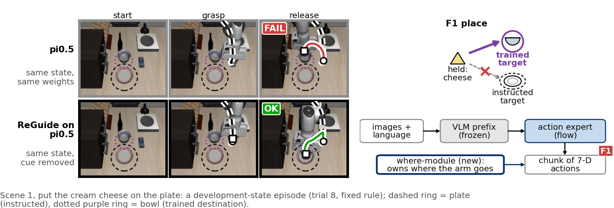
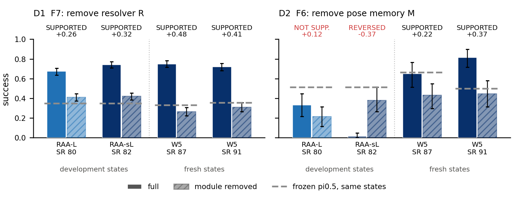
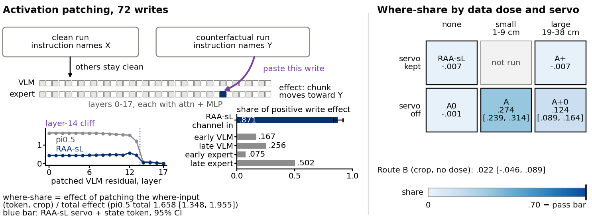

# Routed by Cues: A Failure Atlas of Vision-Language-Action Models on New Pairings

<!-- Title alternatives:
1. Routed by Cues: Why a Learned VLA Cannot Own Where the Object Goes
2. Cues Choose the Sub-Goal, and Training Does Not Teach the Expert to Read the Target: An Analysis of Vision-Language-Action Models
3. A Failure Atlas for New Pairings: Cues Route the Errors, Explicit Modules Repair Them
-->

Bibliography: paper/refs.bib

Draft of 2026-11-23, restructured as a failure atlas (previous draft: docs/history/DRAFT_2026-11-23_pre_atlas.md; review: docs/notes/novelty_review_adv.md). The main text targets 8 ICML pages; the appendix follows the "# Appendix" heading and keeps the detailed results, the ledger pointers (SR = docs/SCAFFOLD_RESULTS.md, AF = docs/ARCH_FAILURES.md) and the registered verdicts. Prose follows the diffusion-composition paper's style rules: active voice, one idea per paragraph, no hedged contrasts. Held-out state sets 1, 2 and 3 are SR 87, SR 90 and SR 91. The oracle and pi0 results come from docs/notes/oracle_pi0_results.md (Appendix K).

## Abstract

Vision-language-action models (VLAs) succeed on trained tasks and fail when a new instruction pairs a known object with a known target. We map these failures into an atlas and ask what repairs each one. On five VLAs, the failures fall into a few kinds (the place follows a cue, the held outline picks the carry, the habitual object is grasped, relational language is ignored, a covered target is lost), and a causal cue test routes each one. Each failure sits in a function that a standard VLA spreads through one learned network. Explicit modules in a separable decomposition own these functions, and removing a module returns exactly its failure on three held-out state sets. Repairs inside the network fall short. On pi0.5, a new input pathway for the exact target stays unread (learned where-share -.007) unless the data force it. On pi0, whose state pathway is trained, the network reads the target (.542 [.478, .609]) and still fails more held-out pairings than with an explicit where-owner (-.256 [-.386, -.128]). Explicit modules repair the failures and take over the function: a where-module inside a retrained policy and an external one converge at .89 to .92 on held-out pairings. All results come from LIBERO, with one training seed per policy (two for RAA-sL) and privileged perception inputs.

## 1 Introduction

A household robot that stacks a cup on a plate and a bowl on a shelf should also put the cup on the shelf. Vision-language-action models (VLAs) reach .98 to 1.00 success on the tasks they trained on and fail on new pairings of the same objects and targets (CRAFT 2610.00524, LIBERO-PRO 2510.03827, LIBERO-CF 2602.17659).

The diagnosis is well established. A VLA keeps its local manipulation skill and loses the global grounding of the instruction. Correcting WHERE, Preserving HOW (ReGuide, 2609.38616) states this division of labour in its title and lifts several backbones with a training-free wrapper that rebinds the referent. Encoded but Not in Control (2610.06235) finds that the instruction's target is linearly decodable in the network and goes unused. We take this diagnosis as the starting point and ask how many distinct failures it covers, what routes each one, and what repairs it.

Our answer is an atlas. For each failure we report where it appears across five VLAs, the cue that routes the wrong outcome (a causal test changes the cue and the outcome follows), a same-state reference planner that shows the input holds the needed information, and a row of repairs: more data, the target as an input, and an explicit module. The atlas rests on one hypothesis about why the repair columns differ. Behaviour cloning has no reason to build a function that the trained tasks never need, because the role phrase, the painted views and the held object already determine the target there. This is the causal-confusion pattern of de Haan et al. (NeurIPS 2019). A function that a standard VLA spreads through one learned network therefore resists repair from inside that network.

**Contributions.**
1. The atlas. Failures of five frozen VLAs on new pairings, each with a causal cue test, a same-state reference planner and an excess-over-partners measure, and a pre-registered cue law for one scene (Section 4).
2. A function for each failure. A separable decomposition (resolver, pose memory, where-module) owns the functions that the failures lack, and removing a module returns exactly its failure on three held-out state sets, with two seeds where available (Section 5).
3. A repair matrix. Repairs inside the network fall short: a dose-by-servo grid on pi0.5 shows that a new target pathway stays unread unless the data force it, and on pi0 the network reads the target (.542) and still fails more held-out pairings than with an explicit where-owner ("read but not in control", which extends Encoded but Not in Control from internal representations to an explicit input). Explicit modules (our servo-based where-module W5, and ReGuide) repair the failure, and the servo takes over the function on both backbones and both seeds of the main retrain (Sections 6 to 8). We state this necessity as an empirical claim over the tests we ran. It carries no proof.

**Scope.** All results come from LIBERO, two scenes and pick-place tasks, with one seed per trained policy (two for RAA-sL). Section 9 lists the privileged inputs and the deviations of the pi0 arms.

## 2 Related work

**Diagnosing held-out pairings.** LIBERO-PRO, LIBERO-CF and LIBERO-Plus (2510.13626) show collapse under perturbed objects and instructions. Robust Skills, Brittle Grounding (2602.24143) separates intact skills from brittle target selection. CRAFT reports 8.4%, 2.8% and 1.1% on held-out pairings for pi0.5, pi0 and GR00T after plain fine-tuning. The atlas adds a causal cue test for each failure, a reference planner on the same states, and repair columns that say which fixes work.

**Where and how.** ReGuide owns the framing of this paper's thesis: it corrects where the arm goes with grounded poses and hands the frozen policy back control. ReGuide shows that an external where-correction works. We add that an explicit where-module inside a retrained policy converges to the same success, and that repairs inside the network fall short even when the network reads the target. Other fixes retrain (CRAFT, ACT-VLA 2607.00351, AC-VLA 2607.15714) or edit a frozen policy (LiLo-VLA 2602.21531, Harness VLA 2607.08448, VP-VLA 2603.22003). w2VLA (2606.21496) splits an atomic command into a skill string and an object string that the frozen VLM text encoder embeds separately; the object embedding yields spatial heatmaps that condition the robot-state tokens through FiLM, and the skill embedding conditions them through a second FiLM block.

**Object-centric architectures.** TAX-Pose (2211.09325), SPOT (2411.00965), FOCI (2609.08743), OA-WAM (2605.06481) and POT-VLA (2607.18016) place actions in object-relative frames or feed role-indexed records to an action expert. Our role channel combines an input restriction with one such channel, and we claim no priority.

**Mechanisms and shortcuts.** Grant et al. (2603.19233v6) inject one task's activations into the action expert while the policy views another scene; the injected task's motor trajectory wins in 99.6% of 1,968 pi0.5 episodes (tie-band conditional), the destination task succeeds on 2.6%, and the effect is weaker on GR00T (57.0%) and SmolVLA. They read the motor program as bound to absolute workspace coordinates. Wulff and Cangelosi (2610.10178) find patching sensitivity spread across layers, which agrees with Section 5. A recent audit (2606.04233) finds that a small DINOv2 probe with no language encoder scores at or near the best reported results on LIBERO, a live concern for shortcut-prone benchmarks. A steerability predictor that failed its registered test sits in Appendix G.

## 3 Setting, measures and the atlas protocol

**Models and scenes.** We test five frozen VLAs trained on LIBERO's 40 tasks (pi0.5, pi0, GR00T N1, X-VLA and SmolVLA) and never retrain them in the atlas. Scene 1 descends from LIBERO-Goal's kitchen and has five trained tasks (K1-K4, K6) and six held-out pairings (N1-N6). Scene 2 is LIBERO-10's living-room scene with two mugs and two plates and one trained task. A held-out pairing combines an object role from one trained task with a target role from another, and its known partners are the trained tasks that share its object and its target. A cue is any visual feature that covaried with a sub-goal in training.

**Atlas protocol.** A failure enters the atlas when three conditions hold. First, the excess failure E on held-out pairings is positive, where E is the failure rate of the pairing minus the failure rate of its known partners, so that E isolates the pairing from the difficulty of the object or the target. Second, a scripted reference planner that reads simulator state succeeds on the same states (.894 on the held-out pairings of scene 1), which shows that the input holds the information the task needs. Third, a causal cue test names the routing cue: we edit or move the candidate cue and the outcome follows the edit. A failure that misses the second condition belongs to the task, and we report it as a limit.

**Learned where-share.** For the repair columns we measure how much a network's behaviour depends on a given input. We replay recorded model inputs open loop and patch the where-input (the state token, or token plus crop) from a counterfactual run, in which the target is shifted, into the original run. The where-share is the fraction of the counterfactual effect on the output chunk that this patch recovers. A share near zero means the behaviour does not depend on the input. A route passes when the lower bound of the pooled share is at least .70 and fails when the upper bound is under .30. A follow share applies the same idea on frames where only the token names the target (Section 6.3).

**Statistics.** Each confirmatory test has a pre-registered ledger row that fixes arms, states, predictions and decision rules before any main rollout. We compute every contrast by a paired bootstrap that resamples tasks and states jointly, with 2,000 draws, and report 95% intervals. Held-out state sets are start states that no earlier experiment used; the atlas and the cue reads on development states are development reads, and we mark them as such.

## 4 The atlas: failures and their cues

The repairs in later sections need a list of what fails and which cue routes each failure, so this section gives that list and keeps each entry to its cue, its causal test and its effect (Appendix L.3 holds the full detail).

**F1, the place follows a cue.** After a correct grasp, the carry and release follow a cue and ignore the instruction's target role. The excess failure on held-out states of scene 1 is +.450 [.28, .61] for pi0.5, +.225 [.05, .43] for pi0, +.500 [.26, .74] for GR00T and +.379 [.04, .73] for X-VLA. The cue test removes the cue by input edit: role views plus role phrases lift pi0.5 from .450 to .817 (Appendix B).

**F1m, the held outline starts the carry.** On pi0.5, the high carry follows the outline of the held object. Painting the held bottle as its box raises N4+N6 from .625 to .812 (+.188 [+.075, +.325]) with no cost on trained tasks.

**F2, the habitual object is grasped.** The grasp excess is +.650 [.39, .88] on pi0 and +.833 [.67, .96] on SmolVLA. Role views alone lift pi0 by +.183 [+.021, +.412].

**F7, relational language is ignored.** On pi0.5 and GR00T the relational choice equals the ambiguous choice on 92.5 to 100% of states. A resolver that turns the relation into one entity lifts pi0.5 from .40 to 1.00 on one family and from .20 to .775 on the negated one.

**F6, a covered target is lost.** A cylinder covers a displaced plate. The cover costs pi0.5 placement precision (cost .38 [.28, .48]) and GR00T the target's location (cost .60 [.51, .68]), and a control with the cylinder beside the plate keeps pi0.5 at .967.

**Scene 2 and a pre-registered cue law.** In scene 2, every model scores 0 of 720 episodes on the two held-out pairings. A pre-registered test on new layouts confirms a majority rule on pi0.5: the place goes to the plate backed by two of three cues (nearer, more salient, trained), on .912 [.883, .942] of 445 placements in which the cues disagree. The views that repair scene 1 give .000 here, so an input edit removes only cues that the task does not need.

**A moved plate.** A moved target would expose trained coordinates held by a VLA. We move the plate in K1 .141 to .296 m away. Frozen pi0.5 succeeds on .975 [.925, 1.000] of far-plate states and releases at the trained position on 0 of 40, while the narrow retrain R2 releases there on 31 of 40 (.775 [.625, .900]) and succeeds on 0 of 40. Narrow fine-tuning therefore induces the position bias. RAA reaches the moved plate on .100 (-.875 [-.975, -.750] against frozen pi0.5), so a repair of one failure can cost robustness elsewhere (Appendix F). A new layout of the scene-1 objects fails the scripted planners too, so we carry it as a limit of the task (Appendix B).

## 5 Where each failure sits: functions and a separable decomposition

If a failure is a missing function, a module that owns the function should repair the failure and its removal should return it. This section names the functions and tests the decomposition.

**Four functions.** F1 and F1m lack an owner of where the object goes and when it is let go. F2 lacks a binding from the named object role to the object that the gripper approaches. F7 lacks a resolution of a relation to one entity. F6 lacks a memory of a target across queries. In a standard VLA these functions share one path: the VLM prefix feeds the action expert, which emits a 50-step chunk of which 5 steps run per query.

**The functions are spread through that path.** Activation patching on frozen pi0.5 writes one component at a time from a counterfactual run into the clean run (Appendix D). The effect spreads across many layers (largest single write .189 [.167, .209], participation ratio .155 [.133, .185] against a .2 criterion), no band of layers is selective, and 4 of 10 band-by-set cells are inverse. We report this as a negative result: the effect does not localise.

**A separable decomposition.** Three explicit modules own the functions. The resolver R turns a relational instruction such as "the bowl on the left" into one entity and serves F7. The pose memory M keeps the last estimate of an entity that a cover hides or a view loses and serves F6. The where-module serves F1 and F1m by aiming the arm at the release point of the target; Section 7 builds it. Figure 4 shows the decomposition on the same frozen pi0.5.

**Removal test.** We run three arms on the same states, with RAA-sL-W5 as the policy: full, no resolver and no memory. The contrasts are the gain of the resolver on the relational cells, the gain of the memory on the covered-plate cell, and the two cross terms. We fixed the design before any rollout, on held-out state sets that no earlier experiment used (Appendix L.2).

**Table 1.** Effect of removing one module (drop in success, 95% intervals, 60 states per cell, one seed) on three held-out state sets. Set 2 runs the module variant W6. Every gate is testable on all three sets.

| held-out state set | remove resolver (relational cells) | remove memory (covered plate) |
|---|---|---|
| 1 | +.483 [+.425, +.538] | +.217 [+.033, +.383] |
| 2 (W6) | +.504 [+.454, +.554] | +.400 [+.267, +.550] |
| 3 | +.408 [+.350, +.463] | +.367 [+.217, +.517] |

**Reading.** Removing the resolver restores the relational failure, removing the memory restores the hidden-target failure, and neither removal moves the other cell (cross terms within an equivalence bound on all three sets). The modules exist to repair these failures, so the test verifies separability in a system we built, and the memory result is a location-memory result in the RAA models that says nothing about memory in frozen pi0.5 (three caveats, Appendix L.2).

## 6 Repairing inside the network

If the missing function could be learned inside the network, the repair would be a training recipe. This section tests three recipes: retraining at matched data with a role channel, giving the network the exact target as an input at several data doses, and the same on pi0, whose state pathway is trained.

### 6.1 The matched-data ladder

We first train the binding into a policy on the same demonstrations as a plain retrain and test whether it closes the place gap. A ladder of retrains on LIBERO-Goal's eight known tasks uses the same 52,181 frames, the frozen VLM, the same action expert, 6,001 steps and one seed. R0 retrains the action expert on whole instructions and frames. R2 restricts the input to the active role's entity, with role phrases and painted views. Rrel is R0 plus the role channel, and RAA is R2 plus it. The channel is the position of the active role entity relative to the gripper, in whole centimetres, entered as a short text suffix on the prompt because the served pi0.5 reads no state input.

**Table 2.** Matched-data results on 60 states per task in scene 1. RAA-s adds a fixed servo residual on the translation dimensions of each chunk to RAA. RAA-sL starts RAA-s from the LIBERO-fine-tuned pi0.5, and the other retrains start from the base weights. ReGuide (rgp) is the external reference.

| variant | N1-N6 | right grasp | placed given right grasp | K1-K6 |
|---|---|---|---|---|
| R0 | .042 | .417 | .100 | .853 |
| R2 | .389 | .972 | .400 | .753 |
| Rrel | .278 | .861 | .323 | .911 |
| RAA | .656 | 1.000 | .656 | .839 |
| RAA-s | .717 | .967 | .741 | .844 |
| RAA-sL (seed 1 / seed 2) | .878 / .822 | .997 / 1.000 | .880 (seed 1) | .936 / .856 |
| rgp (ReGuide) | .897 | .989 | .907 | .950 |

**Input purity repairs the grasp and the channel repairs part of the place.** R2 fixes the grasp (right-grasp rate .972) and places only .400 of those right grasps. RAA beats R2 on held-out pairings by +.267 [+.092, +.467], and its right-grasp rate rises by only .028, so the place step supplies almost all of the gain. The trained tasks stay level (+.086 [+.011, +.172]). The channel needs pure input: Rrel gains +.236 [-.006, +.553] over R0, and RAA beats Rrel by +.378 [+.133, +.658].

**The remaining gap sits at the release.** In 47 of 51 failures, RAA carries the right object to the right target and lets go outside LIBERO's placement tolerance, with misses of 3.7 to 7.9 cm against ReGuide's median of 0.9 to 1.7 cm. Every retrain that supplies the exact offset as numbers or text leaves a gap of centimetres, and a fixed servo term lifts RAA to .717 (RAA-s) and .878 (RAA-sL, two seeds: .878, .822), which raises the question of whether the network reads the number at all (Appendix L.1).

### 6.2 The dose-by-servo grid on pi0.5

In RAA-sL, patching the servo input and the state token together accounts for .871 [.834, .914] of the total effect, and the servo alone carries .878. The state token carries -.007, so the trained pi0.5 expert does not read the value of the newly added token, and a second training seed reproduces this (-.002 [-.0024, -.0017]). Our shortcut hypothesis (Section 1) predicts that a network uses a where-signal only as far as the data force it to and only if no other path supplies the correction. Four data routes test it, with one selection rule fixed before any run (Section 3).

**Routes.** Route A relabels held-phase demonstration frames with a counterfactual goal offset of 1 to 9 cm on a servo-free model, so only the token can supply the shift. Route A0 is the same servo-free model with no relabel, the matched comparator. Route B adds a crop of the target as an extra image input and has no data dose. Route A+ adds planner demonstrations with shifts of 19 to 38 cm, which the prompt and the views do not determine, and keeps the servo. Route A+0 is A+ with the servo removed, a post hoc route that we added after seeing A+'s probe. A control that trains on the same planner data with no token and no servo falls below RAA-sL on held-out pairings by -.247 [-.483, -.030], so the planner data alone do not supply the where-skill.

**Table 3.** The learned where-share by data dose and servo on pi0.5 (96 observations per route on development states, clustered bootstrap, 95% intervals). The pass bar is .70.

| dose | servo | route | learned where-share |
|---|---|---|---|
| none | kept | RAA-sL (seed 1 / seed 2) | -.007 [-.008, -.006] / -.002 [-.0024, -.0017] |
| none | off | A0 | -.001 [-.001, .000] |
| none, target crop | off | B | .022 [-.046, .089] |
| small (relabel, 1-9 cm) | off | A | .274 [.239, .314] |
| large (planner, 19-38 cm) | kept | A+ | -.007 [-.013, -.000] |
| large (planner, 19-38 cm) | off | A+0 (post hoc) | .124 [.089, .164] |

**A newly added pathway stays unread without a dose, and the servo shuts it out.** With no data dose the share is zero (A0 and B). The relabel raises it by +.272 [+.238, +.312] over A0, and the crop adds nothing detectable (+.030 [-.034, +.089]). With the servo kept, even planner shifts of 19 to 38 cm leave the share at the reference value (A+ -.007). The servo accounts for that zero: A+0 reads .124, which is +.133 [+.096, +.171] above A+, and the large dose without the servo does not do better than the small relabel (A+0 minus A is -.150 [-.196, -.104]). No route reaches the .70 bar, and the fifth held-out state set stays sealed. Behaviour agrees: no servo-free route recovers RAA-sL's release aim on held-out pairings (A -.100 [-.261, +.050], B -.233 [-.447, -.019], A0 -.192 [-.406, +.019]), and A+0 reaches .603 against .878 for RAA-sL (Appendix E).

### 6.3 An oracle: can the layer be learned when only the token decides?

The grid leaves open whether the new layer fails because it cannot be learned or because the data never demand it. We test this on 131 observations on 23 layouts in which pairs of frames share a layout and differ in the table spot of the target by at least 15 cm, so that only the token names the spot. The follow share phi is the fraction of the shift between the two spots that the output chunk follows when only the token changes (Table L1, Appendix L.4).

**The layer can be learned when the data force it.** A+0 and A follow the token on the oracle frames (phi .771 [.605, .887] and .662 [.542, .783]), against -.001 for A0, and neither lower bound reaches the .70 bar. With the servo kept, the network follows the token on no oracle frame (A+ -.068, RAA-sL -.006), so the servo carries the where. An arm trained on A+0's data plus 39 paired-spot demonstrations (ORC) reaches phi .777 [.628, .873], level with A+0 (Appendix K).

### 6.4 pi0: the network reads the target and still fails more pairings

The pi0.5 null concerns a pathway that we add, so we repeat the test on pi0, which reads state natively. We put the same token into its trained state dimensions 0 to 3 and train two arms: servo kept, and servo off with no added data (Table L2, Appendix L.4; Section 9 lists the deviations from pi0 as shipped). Both arms pass the fit gate on the trained tasks.

**The pi0.5 null is specific to a newly added pathway.** With the servo off, pi0 reads the token at .542 [.478, .609], which is +.531 [+.463, +.607] above pi0.5's A0. With the servo kept, the share falls to -.150, so the servo suppresses the token here too.

**Reading the token does not give control.** The servo-off arm scores .506 on held-out pairings against .761 with the servo kept, a difference of -.256 [-.386, -.128], with the trained tasks intact (+.094 [+.003, +.208], non-inferior at the margin of -.05). A rule we fixed before the rollouts holds. We call this pattern read but not in control. It extends the finding of Encoded but Not in Control from internal representations to an explicit input: the network reads the exact target and still places worse than a network with an explicit owner of the where.

**Reading of Section 6.** A network can learn to follow an exact target when the data demand it, and following it falls short of owning the where: the servo-free pi0.5 routes stay at .603 to .778 on held-out pairings against .878 for RAA-sL, and pi0 without the servo trails its servo-kept twin by .256. One seed per arm and development states limit these statements (Section 9).

## 7 Repairing with explicit modules

If the network does not own the where, a module must. We give a module sole ownership of the target-directed motion of the same RAA-sL checkpoint at serving time and train nothing. The module owns where the object goes and when it is let go, and the expert keeps how to move: the lift, the approach, the final alignment and the gripper. The final design, W5, aims at the release point that the demonstrations show for the target's class and hands the last 3 cm back to the expert; it took six variants, W1 to W6 (Appendix L.5).

**W5 and ReGuide converge.** On the first held-out state set, W5 reaches .892 on held-out pairings against .914 for ReGuide with perceived poses (-.022 [-.114, +.047]). In a registered replication on a further set with no code change, W5 reaches .894 against .917 (-.022 [-.147, +.069]). Neither lower bound clears the non-inferiority margin of -.10, and the pooled difference over three sets is +.001 [-.053, +.049] (Appendix L.5). Two systems that share nothing but the explicit where reach one value, and no learned route in Section 6 reaches it.

**The servo takes over the function.** Keeping the servo drives the token's share to zero on pi0.5 (A+ -.007 against A+0 .124; oracle frames -.068 against .771) and cuts it on pi0 from .542 to -.150. Both backbones, and both seeds of the main retrain (-.007 and -.002), show the same takeover: once an explicit owner supplies the correction, the network stops using the token.

**The servo alone loses the covered target, and the pose memory supplies it.** A servo aims at the entity's last estimate and cannot follow a plate that a cover hides. The covered-plate cell F6_b scores .000 for pi0 with the servo against .200 with it off, and .017 for RAA-sL against .383 for A0 on pi0.5. W5 with the pose memory scores .817 on the covered plate against .050 for RAA-sL on the third held-out set, and removing the memory costs .217, .400 and .367 on the three sets (Table 1).

**Where the agreement ends.** W5 beats ReGuide on relational language (F7 pool .750 against .375), because ReGuide has no resolver, and its weakest cell, N4, sits below ReGuide on two of three sets. The servo is hand-set, and a target class absent from the demonstrations cannot be aimed (Appendix L.5).

## 8 The repair matrix

A reader needs the atlas and the repairs in one place, so Table 4 collects them. Each row is a failure, and the columns give its cue, the models that show it, the missing function, and the verdict of each repair; "not tested" marks cells that we did not run (Appendix L.6 gives the cell detail).

**Table 4.** The repair matrix. N is held-out-pairing success on development states unless stated.

| failure | routing cue | models | missing function | more data | target as an input | explicit module | removing the module returns it |
|---|---|---|---|---|---|---|---|
| F1, the place follows a cue | held object's identity (scene 1); majority of nearer, salient, trained plate (scene 2) | pi0.5, pi0, GR00T, X-VLA (E +.450, +.225, +.500, +.379) | where the object goes | falls short: A+0 .603; no-token planner data -.247 [-.483, -.030] | falls short: RAA .656, RAA-c .503; pi0 N .506 against .761 | repairs: W5 .892, ReGuide .914 | not in the removal test |
| F1m, the held outline starts the carry | outline of the held object | pi0.5, pi0, GR00T, X-VLA | release control of the held object | not tested | not tested | repairs in part: ReGuide takes GR00T N4 high carry from 1.00 to 0 of 38 (N6 .821); painted outline .625 to .812 | not tested |
| F2, the habitual object is grasped | habitual object in the scene | pi0 (+.650), SmolVLA (+.833) | binding of the named role to the approach | not tested | not tested | repairs: ReGuide lifts pi0 .021 to .608, SmolVLA .021 to .604 | not tested |
| F6, a covered target is lost | the cover over the plate | pi0.5 (cost .38), GR00T (cost .60) | memory of the target across queries | not tested | servo alone loses it: RAA-sL .017, pi0 .000 | repairs: W5 .817 against .050 (set 3) | yes: -.217, -.400, -.367 |
| F7, relational language is ignored | ambiguous choice | all five, at least one family | resolution of a relation to one entity | not tested | not tested | repairs: resolver, pi0.5 .40 to 1.00 and .20 to .775 | yes: -.483, -.504, -.408 |
| Moved plate | trained plate position, after narrow retraining | R2 (31 of 40 at the trained position) | position of the target in the scene | narrow data induce the bias (R2 .000) | RAA .100 | ReGuide .850 and .925 (Appendix F) | not tested |
| New layout | none (the planners fail too) | all five | none that a VLA lacks | not applicable | not applicable | not applicable | not applicable |
| Exact target given, still fails | trained tasks never need the target input | pi0.5: unread; pi0: read, not in control | control from the read target | relabel .274, planner .124, oracle .771 [.605, .887] | pi0.5 -.007; pi0 .542 and N .506 against .761 | the servo takes over: share -.150 (pi0), -.007 (pi0.5 A+) | not a removal: pi0 servo-off retrain -.256 [-.386, -.128] |

**Reading.** More data and the target as an input fall short in every cell we tested, including the cells where the network reads the target. Explicit modules repair the failures we tested them on, in full for F1, F6 and F7 and in part for F1m, and removal returns the failure for the two functions with a removal test (F6, F7). Our claim that a function that a standard VLA spreads through one learned network resists repair from inside it is an empirical claim over these rows and carries no proof.

## 9 Limitations

**Privileged inputs.** The fixes need depth and calibration: the estimator that locates entities uses rendered depth and calibration, and ReGuide's perceived-pose runs use the same perception. Scene-2 role views use simulator masks, and the scene-2 where channel is privileged, with a channel error of 0 by construction. The F7 resolver is a fixed-template rule on a parsed scene, with no language-understanding claim, and the reference planners use simulator state or privileged depth. A calibrated RGB-D sensor would supply these inputs, and an RGB-only policy would not.

**The pi0 arms.** Our pi0 arms deviate from pi0 as shipped: the token enters the trained state dimensions 0 to 3, whose live columns were trained on end-effector position and one rotation component, and the arms use quantile normalisation and no delta actions. The negative share of the servo-kept arm (-.150) is leftover dependence on those columns. The oracle test set holds 131 observations on 23 layouts, below the 240 we planned, and ORC has 39 paired demonstrations in place of 100. The pi0 results rest on single seeds on development states, so the .256 gap on held-out pairings is a single sample.

**Baselines and comparability.** Our ReGuide is a reimplementation from its paper with our segmenter, and it omits the post-hand-back escort. We ran no arms on the CRAFT, ACT-VLA or AC-VLA splits, whose methods reach comparable or higher success without privileged depth, so our numbers are not directly comparable with theirs.

**Statistics and scale.** Every trained policy has one seed, except RAA-sL, which has two (Appendix J). Two seeds do not estimate the seed-to-seed spread: the gaps on held-out pairings (.056) and on trained tasks (.081) are single samples of it, so success differences of that size between single-seed policies are within seed noise. Intervals resample six tasks. The designs W1 to W5 came from diagnoses on development states, and the held-out state sets are free of that selection. The registered tests apply no multiplicity correction. The atlas runs mostly on development states, and only F1 and F2 replicate on held-out states.

## 10 Conclusion

VLAs fail new pairings of known parts in a small number of identifiable ways. A cue routes each failure, and each sits in a function that a standard VLA spreads through one learned network. Repairs inside the network fall short: more data and the target as an input leave a gap even when the network reads the target (pi0 reads it at .542 and trails its servo-kept twin by .256), and on pi0.5 a new input pathway stays unread unless the data force it. Explicit modules that own the function repair the failure and take it over: a where-module inside a retrained policy and ReGuide outside a frozen one converge at .89 to .92, and removing the resolver or the memory returns exactly its failure. The necessity of an explicit owner is an empirical claim over our tests, in one simulator and with single seeds.

---

# Appendix

This part holds every result removed from the main text. SR numbers point to docs/SCAFFOLD_RESULTS.md, AF to docs/ARCH_FAILURES.md, and verdict words are the registered ones. The earlier draft with the full prose of every subsection is docs/history/DRAFT_2026-11-22_pre_reframe.md, and the analysis-paper draft before the atlas restructure is docs/history/DRAFT_2026-11-23_pre_atlas.md; sections here condense them and keep every number. Appendix K holds the oracle arm and the pi0 replication, which Sections 6.3 and 6.4 summarise.

## A Setting details

**Models.** pi0.5 (openpi pi05_libero), pi0 (pi0_libero), GR00T N1 (ar0s/groot_libero), X-VLA (xvla-libero), SmolVLA (smolvla_libero) (SR §50, §65). X-VLA enters the atlas and the F7 reads and misses the transport reads, because its server sends absolute end-effector targets and our ReGuide transports issue delta commands.

**Scenes.** Scene 1 has 11 tasks (SR §55): K1-K4 and K6, and N1-N6 (cheese or wine bottle with plate, stove, cabinet or bowl). It has two layouts, one with the trained start regions and one that shifts them. Scene 2 is LIBERO-10's LIVING_ROOM_SCENE5 (white mug, yellow-and-white mug, red mug, left plate, right plate); its trained task puts the white mug on the left plate and the yellow-and-white mug on the right plate. In scene 2, K1 and K2 are the two halves of the compound, and N1 and N2 re-pair the mugs and plates. The testability floor says a model is testable on a scene only if it scores at least .70 on the trained tasks; scene-2 GR00T scores .508 [.333, .667].

**States.** Scene 1 uses 20 development states, 20 further states and blocks of 40 to 60 states (SR §47, §65, §71). Scene 2 uses 60 (SR §50).

**Reference planner.** U scores .894 on held-out pairings of scene 1 from simulator poses, .883 from camera poses and .881 from a learned segmenter (SR §38.1, §40.1). In scene 2 it scores .967 on N2 and .333 on N1, pooling to .65 [.25, 1.00] (SR §50).

**Criteria for architecture-rooted failures.** C1: the input holds the needed information and the reference planner reaches .80. C2: the failure persists across models (models, chunk length, prompting; no data ladder). C3: a structural change that adds no information removes the failure. A failure that misses C1 belongs to the task. We phrase C3 as "adds no task information beyond a calibrated RGB-D sensor".

**Registration.** Each confirmatory read has a ledger row (m3_prereg) written before any main rollout. Verdicts appear in capitals (SUPPORTED, NOT SUPPORTED, NOT SHOWN, REVERSED, PARTIAL, EQUIVALENT, NON-INFERIOR, UNTESTABLE).

## B The failure atlas in detail

**Table B1.** Measured break by failure and model. E is the excess failure over known partners.

| failure | pi0.5 | pi0 | GR00T N1 | X-VLA | SmolVLA |
|---|---|---|---|---|---|
| F1, scene 1, cross-chunk E, held-out states | +.450 [.28, .61] | +.225 [.05, .43] | +.500 [.26, .74] | +.379 [.04, .73] | +.054 [-.00, .14], no break |
| F1, scene 2, cross-chunk E (SR §50) | +1.000 [1.00, 1.00] | +.908 [.792, 1.00] | +.533 [.167, .858], below floor | | |
| F1m, N4 and N6 (SR §51) | succeeds .04 after a high carry, .66 after a low one | high carry on .67-1.00 of grasps | high carry on at least .78 | high carry on 1.00 | |
| F2, grasp E, held-out states | +.000 [.00, .00] | +.650 [.39, .88] | +.017 [.00, .07] | +.192 [.00, .53] | +.833 [.67, .96] |
| F7, relational choice equals ambiguous choice (SR §45.1, §45.3) | .925 (SP), 1.00 (NG) | ignored on 4 of 6 cells across pi0, X-VLA, SmolVLA, agreement 75-100% | 1.00 (SP), 1.00 (NG, PARTIAL) | see pi0 | see pi0 |
| F6, cost of covering the plate, d - b (SR §45.6, f6_diag) | .38 [.28, .48] | not testable, gate .017 | .60 [.51, .68] | | |
| New layout | NEITHER | NEITHER | NEITHER | NEITHER | NEITHER |

**F1.** Trained tasks run at .98-1.00 on pi0.5 and GR00T in scene 1 (AF §3). SmolVLA fails inside the chunk (within-chunk E +.862 [.73, .96]). The four cross-chunk verdicts replicate from development to held-out states. In scene 2 every model scores 0 of 720 on the two held-out pairings while pi0.5 scores .99 and pi0 .81 on the trained halves; the swapped two-step task scores 0 of 180 and ends in the trained arrangement on .83-.98. Chunk lengths of 2 and 10 change pi0.5 by -.050 [-.250, +.150] and -.042 [-.200, +.100] and GR00T by -.008 [-.117, +.100] and +.083 [-.025, +.233] (SR §32.1). The scene-2 cue series on pi0.5: with the mugs' start positions swapped, 287 of 287 placements go to the start-side plate (SR §57); pi0 gives .993 of 145 (SR §58); with the plates moved, 0 of 116 and 0 of 125 disagreeing placements go to the start-side plate (SR §59); with the nearer plate the less salient one, 158 of 158 placements go to the small nearer plate when it is the trained one, and .859 of 149 to the large far plate when that is the trained one (SR §60). Majority rule (SR §61): trained plate outvoted 153 of 153, salient plate .974 of 151, nearer plate .752 [.660, .843] of 141; earlier layouts replicate at .970 of 427. The planner meets C1 on three layouts (.825-.838) and misses it on three (.725-.788). Fixes: the front end tvpb lifts pi0.5 from .454 to .938 with no trained-task cost (SR §55). The hand-over to a parts policy lifts GR00T from .17 to .84 and pi0.5 from .50 to .85 [+.017, +.675] (NOT SHOWN for pi0.5, SR §44.1). In scene 2 a reimplemented ReGuide lifts pi0.5 to .708 [.650, .775] on N1+N2 and pi0 to .700 (SR §68). The majority rule holds on pi0.5 only; pi0's labels are unresolved on two layouts, and GR00T matches nearer-plate routing below its floor. Grant et al. hold the attention-path probe.

**F1m.** The planner P_min scores .80 on N4 and .80 on N6. From a pre-grasped pose 6 cm above the target the servo scores 25 of 26 and a bare release 21 of 26; with the bottle held above the target pi0.5 places 26 of 26 (SR §51). Painting the held bottle as its box lowers the high-carry share from .225 to .062 and raises N4+N6 from .625 to .812 (+.188 [+.075, +.325]) with no known-task cost (SR §53). On GR00T the same box adds +.025 [-.025, +.100] (UNRESOLVED) at -.070 on trained tasks (SR §56). ReGuide's transport takes GR00T's N4 high-carry share from 1.00 to 0 of 38; N6 still carries high on .821 and reaches .200 (SR §71). GR00T's N6 places 0 of 14 even from above the bowl. The cue is the outline on pi0.5 and does not transfer.

**F2.** Frozen pi0.5 and GR00T grasp the named object at .950-.992 (SR §32.1). On pi0 and SmolVLA .679 and .829 of held-out episodes end at the grasp (SR §65). In scene 2, pi0.5 puts back a held mug the instruction does not name and grasps it again 240 of 240 times (SR §64); after a clear-away carry it takes the named mug on .167 of N2 episodes and after its trained white-mug carry on .967 (SR §67). ReGuide's approach transport lifts pi0 from .021 to .608 and SmolVLA from .021 to .604, with trained tasks at +.020 [.000, +.060] and +.030 [-.020, +.120] (SR §65); in scene 2 it moves pi0.5's first hold to the named mug on 60 of 60 N2 episodes against 0 for the hand-over alone (SR §68). Role views alone lift pi0 by +.183 [+.021, +.412] and do nothing on SmolVLA.

**F7.** With two identical bowls, only the relation picks the referent. With the other bowl removed the models score .825-1.00 and the scripted references .93-1.00 (SR §45.1). Referent share is .475-.50. On pi0, X-VLA and SmolVLA the relation is ignored on 4 of 6 cells; X-VLA and SmolVLA on SP have no power (SR §45.3); F7 holds on all five VLAs on at least one family. A negated LIBERO-PRO instruction scores 0 of 20 on pi0.5 and GR00T against .95 for the trained one (descriptive). A resolver plus a role view paints the other bowl: it fixes 3 of 4 cells with the resolver exact on 160 of 160; pi0.5 goes from .40 to 1.00 (SP) and .20 to .775 (NG), GR00T SP from .30 to .85 (SR §45.2). On pi0, X-VLA and SmolVLA it fixes 0 of 6 cells (resolver exact 240 of 240), because those models fail even the named plate bowl on 0 of 20. GR00T's NG cell is capped at .50 by its unique-name control. Wulff and Cangelosi report that pi0.5 and GR00T N1.7 respond most to empty and directional instructions, with the strongest directional effect in GR00T's early layers; they measure the change in flow-matching loss under patching on LIBERO-10 demonstration steps and do not measure task success or the action chunk, whereas we measure the chunk change of pi0.5 under a left-right swap (.004 in Appendix D), so the two results use different perturbations and different measures.

**F6.** The plate appears displaced and a cylinder then covers it (a never, b after the first query, c from the start, d beside the plate). The planner reaches .839 on 120 states; d keeps pi0.5 at .967 and GR00T at .742. Covering costs pi0.5 .38 [.28, .48] and GR00T .60 [.51, .68]; b stays within .05 of c (+.05 [-.05, +.158] and +.042 [-.033, +.117]); PARTIAL on both models (equivalence bound missed by .058 and .017). A memory overlay raises pi0.5 from .58 to .84 (+.26 [+.15, +.35]) and GR00T from .14 to .28 (+.14 [+.04, +.24]). Failure-mode classification (f6_diag; opaque cylinder with collisions off; LIBERO's On(): bowl centre within 3 cm xy and in contact): of 50 failures of frozen pi0.5 under b (success .583, 120 states), 44 release within 3 cm of the centre (median 1.8 cm) and 6 release 3-10 cm away; the bowl slides about 2.6 cm and ends 4.05 cm from the centre against 2.07 for successes. c gives .533, about b; a gives .942, d .967, the overlay .842. GR00T's b failures release 3 cm or more away on 76%, ending about 21 cm away. The plate leaks into view on 32-49% of later queries; GR00T sits at the rule's boundary and the overlay trails d by -.458 [-.558, -.358]; pi0 is not testable (gate .017).

**New layout.** Success on N1-N6 is .30 on pi0.5 and .08 on GR00T; the scripted servo scores .31, P_min .37 and U .378; all fail on the same states; the demo's fixed top-down grasp holds on 0 of 10 cheese and 0 of 10 bottle states (AF §3). C1 fails, so this is a limit of the task.

**Fixes by group.** Input-only (SR §47-§56, §65-§67): role views plus phrases lift pi0.5 .450 to .817 (+.367 [+.092, +.634]) with trained tasks -.010 [-.08, +.04]; silhouettes beat a grey proxy by +.442 [+.208, +.675]; phrases alone add +.025 [-.15, +.19]; tvpb reaches .938 against .454; on GR00T views add +.186 [+.033, +.361]. In scene 2 views give .000 on pi0.5 and GR00T; before a hand-over they lift N1+N2 to .508 at -.108 [-.158, -.058] on trained tasks. On pi0 and SmolVLA tvpb costs trained tasks -.485 [-.725, -.220] and -.935 [-1.00, -.810]. Transport-level (ReGuide reimplementation): pi0.5 .929 against tvpb .938 (+.008 [-.083, +.092], EQUIVALENT); GR00T N1-N6 .212 to .838 (+.625 [+.350, +.879]); scene 2 N1+N2 .708 on pi0.5 and .700 on pi0, beating our hand-over by +.350 [+.242, +.458]; without rendered depth .700 [.633, .775] on pi0.5 and .608 on pi0. Our hand-over reaches .442 (simulator) and .450 (perception). Resolver and memory composite RC (SR §70): beats ReGuide alone on F7 by +.550 [+.488, +.625] (SP) and +.663 [+.587, +.738] (NG) with trained tasks -.008 [-.025, .000]; on F6 the slot lifts pi0.5 from .517 to .817 (+.300 [+.167, +.433]); RC beats ReGuide by +.167 [+.050, +.284]; ReGuide's pose registration shows no measured memory (+.117 [-.033, +.267]); on pi0 the composite beats ReGuide on SP by +.375 and costs K1t -.100 [-.183, -.033] (PARTIAL).

**N1 residual in scene 2.** N1 stays at .417-.500 under perceived poses and reaches .833-.900 under simulator poses (SR §68, §72). The rigid held-mug estimate sits 5.65 cm off at release; a box tracker leaves it at 5.71 cm (N1 +.133 [-.033, +.283], NO CLEAR DIFFERENCE; N2 fell by .583). Swapping the simulator's held-mug pose gives .567 against .500 (+.067 [-.067, +.200]), the target-plate pose .450 (-.050 [-.183, +.084]); the oracle variant reaches .900, +.333 [+.183, +.467] over the held-mug swap, which also switches the interaction rule. The reading of the hold and release events is untested.

## C The module-owned where and the removal test in detail

**Table C1.** The W1-W6 chronology (serving-time changes of the RAA-sL checkpoint, no retraining; SR §84-§91). Development states unless stated.

| variant | what the module owns | outcome |
|---|---|---|
| W1 | xy of every chunk row while the role is the target (saturating servo, gain 46.875/m, clip at 2 cm) | covered plate F6 .017 to .817; trained tasks -.408 [-.720, -.119] (K1-K6 .528); K3 .967 to 0, K5 .683 to 0 |
| W2 | W1 plus a closed-gripper command while the bowl is more than 2 cm from the target | F6 .900; K1-K6 .542; unique-name controls .458 fail their gate |
| W3 | xy only while the held object stands at least 3 cm above the target's reference height | K3 0 to .967, K4 .283 to .983, N3 .333 to .850; K1-K6 .814; N1-N6 .922; F6 .717; K5 .067 |
| W4 | W3 plus W2's release gate | N1-N6 .928 (non-inferior to ReGuide, +.025 [-.053, +.111]); K1-K6 .819; F6 .867; K5 .067; controls .467 |
| W5 | release-point aim C1 (servo input minus the class's median release offset mu) plus 3 cm hand-off C2 | held-out set 1: N1-N6 .892, K5 .950, covered plate .650; non-inferiority to ReGuide not shown |
| W6 | release envelope plus target latch | held-out set 2: N1-N6 .764 against .931 for W5 (-.167 [-.392, -.011]); cabinet-top N2 .317; latch a null (+.008 [-.028, +.061]) |

Diagnoses behind the steps: under W1 the held object has moved 3 cm sideways 4-5 steps after the lift and touches the elevated target while more than 5 cm away (K3 20 of 20; K5 16 of 20 stall); demonstrations begin xy transport at a median 7.5 cm below the target's reference height (SR §85). The rack's reference lies 12.5 cm in xy from where demonstrations release the object, against 0.9 (plate), 3.5 (stove) and 5.3 cm (cabinet) (SR §86). The module's held-object estimate has median error 0.95 cm and p90 2.8 cm; its open-loop 5-step chunks pass through the target in 45% of chunks starting 1-4 cm away against 11% for the expert; success falls from .983 to .438 as channel error grows from under 0.5 to at least 2.0 cm while RAA-sL goes from 1.000 to .867. mu table: plate (-0.47, -0.15) cm, bowl (+0.29, -0.03), stove (-3.31, -0.82), cabinet (+4.23, -3.23), rack (-8.94, +8.13).

**Table C2.** Cells on held-out state sets 1 / 2 / 3 (SR §87, §90, §91; 60 states per cell). W6 ran on set 2 only.

| cell | W5 | W6 (set 2) | RAA-sL | rgp |
|---|---|---|---|---|
| N1-N6 | .892 / .931 / .894 | .764 | .875 / .853 / .878 | .914 / .883 / .917 |
| N4 | .717 / .783 / .533 | .667 | .783 / .767 / .817 | .867 / .717 / .800 |
| N6 | .767 / .900 / .900 | .883 | .833 / .750 / .767 | .733 / .750 / .800 |
| K1-K6 | .947 / .964 / .936 | .947 | .939 / .939 / .944 | .958 / .972 / .942 |
| K5 (rack) | .950 / .967 / .950 | .833 | .650 / .667 / .767 | .817 / .883 / .733 |
| K6 | .833 / .900 / .867 | .883 | 1.000 / .967 / 1.000 | .983 / 1.000 / .983 |
| F6_b (covered plate) | .650 / .583 / .817 | .800 | .067 / .100 / .050 | .683 / .700 / .667 |

On set 1, the contrasts of W5 and its components: K5 .950 against .017 (W4) and .650 (RAA-sL, +.300 [+.200, +.417]); W5c1 alone .800, W5c2 alone .017, so C1 carries the rack. C2 recovers part of the controls (W5c2 minus W4 +.083 [+.028, +.144]; F7 pool +.058 [+.017, +.100]) at F6_b -.150 [-.267, -.033]. Controls stay below RAA-sL (-.094 [-.139, -.050]; left unique-name .683 against .933). On the covered plate W5 beats RAA-sL (+.583 [+.467, +.717]) and ties frozen pi0.5 (.650 against .667, -.017 [-.200, +.183]); on set 3 it beats it (+.317 [+.150, +.467]); pooled +.139 [+.033, +.239]. On set 1, W5 versus RAA-sL on N1-N6 +.017 [-.067, +.086]; K1-K6 +.008 [-.103, +.142].

**Replication on set 3 (registered).** N1-N6 W5 .894 against ReGuide .917 (-.022 [-.147, +.069], NOT SHOWN); W5 against RAA-sL +.017 [-.125, +.128]; K1-K6 non-inferiority at -.05 NOT SHOWN (-.008 [-.092, +.089]); F6_b W5 .817 against .050 (+.767 [+.667, +.867]) and .500 for frozen pi0.5; K5 .950 against .767 (+.183 [+.067, +.300]).

**Why W5 loses where it loses (SR §88, replays of 480 outcomes, 20 states per cell chosen because W5 failed).** W5 success falls with hand-off height: .70 (0-6 cm above the target), .54 (6-9), .27 (9-12), .14 (above 12), over 111 hand-offs. On N4 the hand-off height is 11.7 cm and the arm presses the cabinet for at least 10 steps in 65% of W5 failures against 6% for W4. On K6 and K1 W5 crosses the hand-off radius at 5.8-6.4 cm per chunk against 2.8 and overshoots by 2.6 cm on K6 failures. On N6, 12 of 14 failures show a held-phase channel error above 5 cm. On the unique-name control the module's estimate of the held bowl grows to a mean maximum error of 5.1 cm for W5 against 2.5 for RAA-sL. W6's release gate fires in 992 of 1,581 held cabinet calls (63%) against 160 of 821 under W5c1 (20%), from two job files and no gate-off arm. W6 on the hidden plate .800 against .583 for W5, controls .561 against .717 for RAA-sL. N4 is W5's weakest cell on all three sets (.717, .783, .533), post hoc.

**Pooled secondary analysis (SR 87, 90, 91; sets 1 and 2 seen before registration).** W5 minus ReGuide on N1-N6 +.001 [-.053, +.049] (per set -.022, +.047, -.022; non-inferior at -.10; NO CLEAR DIFFERENCE); W5 minus RAA-sL +.037 [-.020, +.090]; K1-K6 +.008 [-.047, +.072]; F6_b over RAA-sL +.611 [+.539, +.683]; K5 +.261 [+.194, +.328].

**Module removal, development history.** Gates: R0 fit gate not rerun on set 1 (RAA-sL's K1-K6, .939, used instead). RAA checkpoint: full .888 on trained tasks, .083 on the F6 unmoved-plate control and .108 on unique-name F7 controls (frozen pi0.5 .967 on the F6 control); D1 SUPPORTED +.213 [+.131, +.300], D2 NOT SUPPORTED +.050 [.000, +.117], primary NOT SHOWN (SR §79). RAA-L (LIBERO-fine-tuned initialisation): held-out .575 against .656 (-.081 [-.181, +.022], NOT SUPPORTED); gates testable (F6 control .967, controls .558, trained .958); D1 +.263 [+.213, +.313]; D2 +.117 [-.017, +.250] NOT SUPPORTED (full .333, below frozen pi0.5's .517; channel median error on the hidden plate 5.1 cm); D3b -.031 [-.069, +.006] (SR §80). RAA-sL: gates testable (.983, .600, .9625); D1 +.319 [+.269, +.375]; D2 REVERSED -.367 [-.500, -.250] (full .017 [.000, .050], without M .383 [.267, .517]; the reversal did not recur on seed 2, Appendix J); primary NOT SHOWN (SR §82). Diagnosis (exploratory): over 523 target-role queries the channel's median error is 1.31 cm on the covered plate and 1.12 on the unhidden; releases land 3-7 cm away, 0 of 52 succeed; the last target query has median xy offset 5.4 cm (covered) against 1.4; the expert's xy opposes the servo in the second half of the target phase (cosine -.92, -.74, -.64); the cover (radius 11.35 cm against the plate's 6.85) hides the plate so braking fires 3-6 cm short (44 of 59 release 3-10 cm away, 2 of 59 within 3 cm). The hide-from-expert ablation was not run. Held-out set 1: gates .900, .572, .967; D1' SUPPORTED +.483; D2' SUPPORTED +.217 (.650 to .433); D3a EQUIVALENT (identical on 60 states); D3b -.054 [-.100, -.012] EQUIVALENT; DK NON-INFERIOR 0 [0, 0]; primary DISSOCIATION SHOWN (raasw5_wa_gated.json); removing M raises 3-10 cm releases by 14 and 16 on sets 2 and 4. Set 2 (W6): gates .917, .561, .958; D3a 0 [0, 0], D3b -.033 [-.075, +.008]. Set 3: gates .975, .561, .917; F6 b .817 to .450; D3b -.008 [-.046, +.029]; primary DISSOCIATION SHOWN (raasw5r_wa_gated.json). The relational "position" template scores 0 for every non-composite arm.

**Scene 2 (SR §89).** W5 and RAA-sL on scene 2, 60 states per cell, one seed. The fit check failed for the unprivileged channel, so the registered channel is the simulator's (object and target positions and in-hand offset privileged; channel error 0). Without that channel W5-S2 scores 0 of 60 on K1 and N1+N2 falls from .817 to .008. K1+K2 .700 for W5-S2, K2 weakest (.483 W5-S2, .55 RAA-sL-S2). N1+N2: W5-S2 .817 against .708 for ReGuide (+.108 [+.017, +.200], A2b SUPPORTED by the lower bound; not like for like since W5-S2's channel and views are privileged); against RAA-sL-S2 (.792) +.025 [-.050, +.108] INCONCLUSIVE. K1+K2 .700 and .742 against .992 for ReGuide. D1' SUPPORTED +.433 [+.358, +.517] (K1+K2 to .325). The held-estimate share is at most .149 against a gate of .20, so D2' and the gated dissociation are UNTESTABLE.

## D Activation patching on frozen pi0.5 (SR §83)

The probe replays recorded inputs open loop and patches one write at a time from a counterfactual run (instruction names another target) into the clean run, over the 72 attention and MLP writes of the 18 VLM and 18 action-expert layers. The 124 observations come from F7 (40), held-out pairings N (48) and trained tasks K (36). The registered claim was a distributed binding: the largest write under .3 of the positive effect and a participation ratio, as a share of the 72, of at least .2. Total effect 1.658 [1.348, 1.955]. Largest write .189 [.167, .209] (action-expert layer 14 attention); participation ratio .155 [.133, .185], below .2, so the criterion is not met; the effect does not localise (largest write far under .5). The F7 set is untestable for the share statistics: a left-right swap moves the chunk by .004 [-.002, .011]; N and K respond (total effect 1.565 and 3.620). Of 10 band-by-set cells with a measurable intact effect none is selective and 4 are inverse: zeroing the early VLM band or either expert band raises F7's correct-target displacement, and the late expert band (layers 9-17) removes .91 of the trained tasks' displacement and leaves F7 unchanged or higher. Residual-stream patches (descriptive): patching the VLM residual at layers 0-12 transfers the full effect (1.66 to 1.53), falling from 1.21 at layer 13 to .10 at layer 14; RAA-sL .45 to .05. The expert reads the prefix through the keys and values of layer 14. Limits: one noise draw per observation, two models, one scene family, single writes sum to more than the total (coverage 2.13). On RAA-sL: largest write .180 [.141, .230], participation ratio .202 [.148, .254]; servo input plus state token .871 [.834, .914] (bar .7); servo alone .878; token -.007; .987 on held-out pairings, .841 on trained tasks, -.006 on F7; selectivity .23 [.04, .44], short of the registered margin. Band shares for pi0.5: early VLM .167, late VLM .256, early expert .075, late expert .502. A targeted registered patching test of instruction-token versus cue-token keys and values at layer 14 is a possible follow-up (TODO(pending): not run).

## E The routes in detail (SR §RAA-F; docs/notes/raaf_plan.md, raaf_sel.md)

The selection rule (fixed before any run): pass when the lower bound of the pooled share on development states is at least .70, the prefix share is below RAA-sL's (.089) and the effect is positive; fail when the upper bound is under .30. A0 was trained after we found B was built servo-free too; A+0 carries prereg tag raafp0 and would have had its only confirmatory test on the sealed fifth set, which stays unbuilt. Contrasts: A minus A0 +.272 [+.238, +.312]; B minus A0 +.030 [-.034, +.089]; A+ minus A -.282 [-.322, -.247]; A+ minus A0 -.006 [-.012, +.001]; A+0 minus A+ +.133 [.096, .171]; A+0 minus A0 +.127 [.092, .165]; A+0 minus A -.150 [-.196, -.104].

**Table E1.** Development behaviour of the routes (60 states per task, one seed). F6_b arms ran on different state sets, so comparisons are indicative.

| arm | N1-N6 | K1-K6 | F6_b | F6_a | F7 pool |
|---|---|---|---|---|---|
| RAA-sL | .878 | .936 | .017 | .983 | .744 |
| A | .778 | .994 | .433 [.317, .567] | .933 | .706 |
| B | .644 | .850 | .600 [.467, .717] | .950 | .694 |
| A0 | .686 | .831 | .383 [.250, .517] | 1.000 | .700 |
| A+ | .828 | .947 | .033 | .417 | .688 |
| A+ctrl | .631 | .814 | .000 | .000 | .413 |
| A+0 | .603 | .814 | .017 | .083 | .625 |

A stays non-inferior to RAA-sL on K1-K6 (+.058 [-.006, +.167]); A+ is -.050 [-.192, +.061] below on N1-N6 with K1-K6 +.011 [-.028, +.067]. The relabel adds +.164 [+.006, +.403] on K1-K6 and +.194 [+.050, +.367] on the bottle pairings over A0. The F6_b rise over RAA-sL (+.417 for A, +.367 for A0) is already in A0, so it comes from removing the servo (A minus A0 +.050 [-.100, +.217]); B adds +.217 [+.050, +.383] over A0 through the prefix, with no learned share. F6_a is low (A+ .417, A+ctrl .000, A+0 .083) only for the models trained on table-spot data. A+0 against RAA-sL: N1-N6 -.275 [-.447, -.119] (REVERSED), K1-K6 -.122 [-.308, +.008] (NOT SHOWN), F7 -.119 [-.188, -.044] (REVERSED); against A+ N1-N6 -.225 [-.386, -.078]. The prefix half of the pass rule fails every servo-free route by construction: RAA-sL's prefix share is .089 because its effect runs through the servo outside the network, and a servo-free route has no outside path (A0 reads 1.002, A .751, lower than A0 by .250 [.218, .285], and B 1.001). A+ctrl's Phase B used a new serving copy with a zero state and learned masks, unlike Phase A. The relabel cannot reach the 20-40 cm scale of a real mis-pairing, because shifts must stay in the support of the demonstrations. Alternative explanation for A+'s null: the new prompt phrase on the table-spot frames; A+0 keeps the phrase and rises to .124, so the servo accounts for the zero. The oracle frames (Appendix K.1) show that A+0 and A follow the token where only the token decides (phi .771 and .662), and pi0 with a trained state pathway reads the token with no dose (Appendix K.3), so these null shares apply to a newly added pathway.

## F The moved plate in detail (SR §81)

Plate cells span 4.0-6.9 cm (near) and 14.1-28.9 cm (far); bowl cells 4.2-6.9 and 14.6-29.7 cm for K1 and 4.1-6.9 and 14.5-29.6 cm for K2. The registered prediction that frozen pi0.5 shows a trained-release share above 0 reads NOT SUPPORTED (M1, predicted at 85%); M1 is weak by construction, since the in-range share is 0 by the 3 cm rule. R2 in range reaches .675 [.525, .825], below the .70 floor. RAA minus frozen pi0.5 -.875 [-.975, -.750] reads REVERSED against the prediction (M2). With the bowl .14-.30 m away, frozen pi0.5 succeeds on .375 [.225, .525] of K1 and .400 [.250, .550] of K2, against .850 and .925 for ReGuide with perceived poses (+.475 [+.275, +.650] and +.525 [+.375, +.675]). The record does not say where the arm goes when the grasp fails; the reach attribution is confounded by the approach path.

## G A steerability predictor (failed its registered test)

The probe sends, at every query of a closed-loop rollout of a trained task, a side query on the same observation with one word swapped (object word in the grasp phase, target word in the place phase). A query scores 1 when the first five steps of the chunk point nearer the swapped-in entity; steerability g_s(o) and p_s(t) average that, and the prediction is the product g_s(o) times p_s(t) (Okawa et al.'s product form). 16 policies in scene 1 and 3 in scene 2, 10 states per trained task (SR §74). The registered headline on the 24 wrapper-free cells gave AUC .550 [.000, 1.000], Spearman .227 [-.440, .812] (NOT SUPPORTED); across 15 policies the Spearman with N1-N6 success is .193 [-.424, .736] (NOT SUPPORTED); trained-task success alone gives AUC .800 on the four wrapper-free policies; the scene-2 test failed its bar.

| score | cells | AUC | stage |
|---|---|---|---|
| steerability, wrapper-free policies | 24 | .550 [.000, 1.000] | registered headline |
| steerability, scene 1 | 90 | .742 [.526, .907] | registered, missed .75 by .008 |
| trained-task success alone | 90 | .645 [.419, .846] | baseline |
| nonsense-word sensitivity | 90 | .462 [.240, .684] | baseline |
| k x a (success times floor-corrected steering) | 90 | .787 | post hoc |
| k x a, Rrel and RAA | 12 | .944 [.667, 1.000] | pre-registered, new policies |
| k x a, all policies | 102 | .805 [.603, .940] | pre-registered, new policies |
| trained-task success alone, Rrel and RAA | 12 | .500 | baseline |

Two problems explain the failure: the angle rule has a floor (.22-.28 of scene-1 queries point nearer the swapped-in entity under the true prompt), and the entity decides most of the score (swaps to the bottle .13-.47; to the bowl target .00-.46). Subtracting the floor raises the 90-cell AUC to .770; k x a gives .787 and Spearman .579; entity normalisation lowers it to about .60-.65. The confirmation covers two policies from one base, six pairings and one scene; its lower bound of .667 sits below the .75 bar and both policies sit at .94 trained success. Pooled Spearman .575 [.254, .756]; the score ranks RAA above Rrel (.364 against .301) as their success does (.656 against .278); Rrel on N1 scores .393 and succeeds on 0. Within GR00T variants Spearman is .922 over 18 cells. ReGuide, Hp and RC lie outside the probe. Prior art: Okawa et al. (product form), STAGE and LIBERO-PRO (sensitivity probes), world-model evaluators (2512.10675).

## H Ladder details (SR §73, §76-§78b, §82)

RAA beats R2 on placed given right grasp by +.256 [+.077, +.461]; the cheese pairings gain +.322 [+.005, +.717] and the bottle pairings +.211 [+.078, +.367]. V3: RAA trails ReGuide by -.242 [-.464, -.033], missing the -.10 margin. Contact-induced training roles: all 300 routed demonstrations had a hold event; the channel stays within 1 cm of the simulator for 69% of object-role and 89% of target-role queries (medians 0.30 and 0.06 cm). On N4 and N6, Rrel grasps the right object on .733 and .567 of episodes. In the exploratory diagnostic (160 episodes), ReGuide's median release error is 0.9-1.7 cm and RAA's failed releases miss by 3.7-7.9 cm; on the bottle pairings the error tracks the held object's offset (r = .57 on N4). RAA-o: r = .14 (N4), .03 (N6), error N4 6.5 against 7.0 cm; trails ReGuide -.303 [-.481, -.111]; NOT SUPPORTED. RAA-c: median error of the fed target .94 cm; trails ReGuide -.394 [-.608, -.158]; known-task .814 against .881 (-.067 [-.233, +.061]); failed releases N4 11.8 against 6.5 cm; NOT SUPPORTED. RAA-s (re-serve with the servo after a serving bug that omitted it): .717 against .656, .594 and .503, trained .844; PARTIAL (+.122 [-.019, +.264]); placed given right grasp +.140 [+.008, +.280]; bottle pairings +.261 [+.133, +.400], cheese -.017 [-.133, +.067]; over RAA-c +.214 [+.075, +.381]; over RAA +.061 [-.117, +.253]; failed bottle releases 6.5 (N4) and 3.8 cm (N6) against 11.8 and 11.0 for RAA-c; ReGuide leads by -.181 [-.300, -.055]; trained-task non-inferiority NOT SHOWN (-.036 [-.178, +.075]). RAA-sL: .878, trained .936, right grasp .997; against RAA-s +.161 [-.017, +.311] NOT SUPPORTED; against RAA-L (.575) +.303 [+.042, +.567] SUPPORTED; bottle pairings .883 against .589 (+.294 [+.183, +.400]); cheese +.028 [-.167, +.267]; trained +.092 [+.011, +.200]; against ReGuide -.019 [-.106, +.061], non-inferiority at -.10 NOT SHOWN (lower bound .006 under the margin); N4 18 of 20 against 13.

## I Prior art and limits, extended

Each component exists: FOCI predicts motion in an object-relative frame; OA-WAM (relative-pose bias between object slots and robot slot, the closest precedent for our channel) and POT-VLA feed object tokens or role-indexed records to an action expert; w2VLA injects a language-conditioned location through FiLM; AC-VLA and LiLo-VLA restrict the input by gripper phase (docs/NOVELTY.md; reports/novelty_raa.md). We read FOCI, OA-WAM and POT-VLA in full text through a summarising fetch and the others by abstract. Other limits not in the main text: the hand-over idea has prior art in ReGuide, Harness VLA and LiLo-VLA; MEM and pi0.7 add memory by training; no hand-over variant of ours clears the .50 bar and holds trained tasks; we ran no placement checks on the F7 and F6 states of held-out sets 1-3; the SR 88 causes come from replays of selected states; no effect was found from chunk length (SR §32.1) or release timing (AF §2.3); we did not reproduce the partner-count law (Wang et al. 2607.29687) on two frozen VLAs (SR §35.1); the new-layout limit carries no VLA claim; the recipe's hand-set constants are one gain, one clearance, one hand-off radius and one release table. Memory and occlusion benchmarks exist for the covered-target failure: RoboMME ("RoboMME: Benchmarking and Understanding Memory for Robotic Generalist Policies", 2603.04639) covers temporal, spatial, object and procedural memory, and LIBERO-Mem ("Rethinking Progression of Memory State in Robotic Manipulation: An Object-Centric Perspective", 2511.11478) covers object-level partial observability. We ran neither.

## J Second training seed of RAA-sL (SR 82 second seed, docs/notes/sr82_s43.md; prereg experiments/prereg/raaslS2_pred.txt)

We trained RAA-sL again with seed 43 (seed 1 used the config default 42). The seed also changes the random initialisation of the state-projection layer and the data order. Everything else is SR 82: data, norm stats, servo constants, 6,001 steps, the same states (development states; no held-out state set is involved) and the same readers. We wrote the predictions and the replication rule before any seed-43 training job. The rule: N1-N6 and K1-K6 REPLICATE if the point gap is at most .05 and are CONSISTENT if the gap is larger and the two 95% intervals overlap; D1 REPLICATES if it keeps its sign and its SUPPORTED verdict; D2 is reported with no claim; the in.tok where-share REPLICATES if its interval upper bound is under .30 and |point| < .05, and the servo and channel shares REPLICATE if each lies within .10 of seed 1.

**Table J1.** Seed 1 (SR 82) against seed 2 (paired bootstrap on the same states, B = 2000).

| quantity | seed 1 | seed 2 | gap | verdict |
|---|---|---|---|---|
| N1-N6 success | .878 | .822 | -.056 [-.181, +.056] | CONSISTENT |
| K1-K6 success | .936 | .856 | -.081 [-.261, +.022] | CONSISTENT |
| D1, full minus noR, F7 pool | +.319 [+.269, +.375] SUPPORTED | +.444 [+.394, +.494] SUPPORTED | | REPLICATES |
| D2, full minus noM, F6_b | -.367 [-.500, -.250] REVERSED | -.067 [-.200, +.083] NOT SUPPORTED | | reported only, no claim |
| probe in.tok where-share | -.007 [-.008, -.006] | -.002 [-.0024, -.0017] | | REPLICATES |
| probe in.servo / in.chan share | .920 / .913 | .911 [.878, .946] / .909 [.876, .944] | -.009 / -.004 | REPLICATE |

K gap: K5 drives it (.683 on seed 1, .200 on seed 2); K1-K4 and K6 lie within .035 of seed 1. Bottle pairings N4-N6 fall from .883 to .772 and cheese pairings N1-N3 stay at .872. P1 (against RAA-s) stays NOT SUPPORTED (+.106 [-.044, +.258]), P2 (against RAA-L) stays SUPPORTED (+.247 [+.064, +.445]), and P3a (against ReGuide) stays NOT SHOWN (-.075 [-.206, +.039]). PK, the K non-inferiority over RAA-s, does not recur (+.011 [-.086, +.078], NOT SHOWN, against +.092 [+.011, +.200] on seed 1). Full F6_b rises from .017 to .133, still far under the unhidden F6_a (.95) and under frozen pi0.5 (.517), so the hidden-plate failure recurs and the seed-1 collapse to 1 of 60 was partly seed-specific. D3a, D3b and DK keep their labels, and the gates stay TESTABLE (.950, .692, .975) with the gated primary NOT SHOWN. The held-target channel has median error .85 cm at test with only role ids 1 and 2 on the state lines.

**Deviation.** The registered CONSISTENT rule compares each seed's own interval. The read produces only the paired seed-2 minus seed-1 interval, so we established CONSISTENT by that interval containing 0, which implies that the two per-arm intervals overlap. We did not compute the per-arm intervals. The ledger row is dirty (foreign uncommitted edits in the tree), and the read script's self-test was not rerun (the machinery is unchanged). **Limits.** One extra seed, one trial per state, 60 states per Phase A task, and both seeds share all state sets, so the replication adds no confirmatory claim beyond SR 82's own status.

## K Oracle arm and pi0 replication (docs/notes/oracle_pi0_results.md; docs/notes/plan_oracle_pi0.md)

This appendix reports Exp 1 (an oracle arm, Section 6.3) and Exp 2 (a pi0 replication, Section 6.4). We executed both on 2026-11-22 and 2026-11-23, with pre-registration rows `pz` (b715f7dc), `orc` (1c6977ab), `orc_arm` (d7404080) and `pzdev` (8fccf20a), and with predictions in experiments/prereg/pz_pred.txt, orc_pred.txt and pzdev_pred.txt. Each arm has one seed and all reads use development states, as every RAA-F route does.

**Design.** The pi0 arms use openpi's pi0 with its native, trained state pathway. The token (the same offset as RAA-c) enters state dimensions 0 to 3 of the trained state projection, with quantile normalisation and no delta actions (pi0_libero as shipped predicts action minus state), so the arms deviate from pi0 as shipped. pi0-sL keeps the servo and pi0-A0 removes it with no added data. The checks pz_check 1 to 3 confirm that the pi0 port equals openpi's Pi0 exactly, that the servo identities hold, that the parameter tree equals pi0_libero's (50 tensors) and that the state projection is bit-equal to the shipped one.

### K.1 Follow share on oracle frames (131 observations, 23 layouts; clustered bootstrap, B = 2000, rng 0)

| model | phi (95% CI) | label | c_clean | phi_zero | sigma_demo |
|---|---|---|---|---|---|
| A+0 (servo off, planner dose) | .771 [.605, .887] | PARTIAL | .676 | .166 | 1.61 |
| A (small relabel, servo off) | .662 [.542, .783] | PARTIAL | .447 | .043 | 1.33 |
| A0 (no dose, servo off) | -.001 [-.002, .000] | NOT LEARNED | -.329 | .001 | -.002 |
| A+ phi_net (servo kept) | -.068 [-.210, .042] | NOT LEARNED | .821 | -.024 | -.168 |
| RAA-sL phi_net (servo kept) | -.006 [-.008, -.005] | NOT LEARNED | .892 | .001 | -.014 |

phi_total (token and servo from the counterfactual): A+ .830 [.737, .911], RAA-sL .957 [.906, 1.006], so the servo carries the where. Cluster-paired contrasts: phi(A+0) minus phi(A0) +.772 [+.606, +.887]; c_clean(A+0) minus c_clean(A0) +1.006 [+.819, +1.189]; phi_net(A+) minus phi(A+0) -.839 [-1.029, -.665] (the servo effect on oracle frames); phi(A+0) minus phi(A) +.109 [-.018, +.219]. The registered gate (train ORC unless A+0 is LEARNED) fired, because the lower bound .605 of A+0 is under .70. The test set has 131 observations on 23 layouts; the registered cap of 250 attempts per object stopped generation at 16 complete pairs (bowl) and 8 (cream cheese) instead of 20 and 20, which still passes the k1 floor of 120 observations. The replay check restores the end effector to 0.000 mm for 48 of 48 stored demonstrations.

Labels for the registered predictions: o1 (A0 phi CI upper < .30) TRUE; o2 (RAA-sL phi_net CI upper < .30) TRUE; o3 (A+ phi_net CI upper < .30) TRUE (.042); o4 (A+0 phi point .50, range .15 to .85) in range with point .771, A+0 LEARNED (30%) FALSE, A+0 NOT LEARNED (25%) FALSE (PARTIAL); o5 (A+0 c_clean above A0 c_clean, CI lower > 0) TRUE.

### K.2 ORC: A+0's data plus 39 paired-spot demonstrations (prereg `orc_arm`)

ORC (pi05_g8v_raac_lo_ae) trains 6,001 steps (step-0 loss .0781) on A+0's data (400 base and 100 planner demonstrations) plus 39 paired-spot demonstrations: 7,659 held frames against 5,306 for A+0 (+44%).

| model | phi (95% CI) | label | c_clean | phi_zero | N + K in.tok share | K / N capture success |
|---|---|---|---|---|---|---|
| ORC | .777 [.628, .873] | PARTIAL | .727 | .033 | .195 [.124, .278] (N .338, K .077; in.prefix .565) | .825 / .4375 |
| A+0 | .771 [.605, .887] | PARTIAL | .676 | .166 | .124 [.089, .164] | |

phi(ORC) minus phi(A+0) +.005 [-.058, +.066]; c_clean +.051 [-.022, +.128]; phi(ORC) minus phi(A0) +.777 [+.629, +.873]. Adding 39 paired-spot demonstrations did not move phi. We did not run ORC development rollouts, which the plan registered only if the N + K share had a lower bound of at least .70. The N + K probe used `--rows inputs`. Labels: o6 (ORC phi point .75) in range at .777, ORC LEARNED (55%) FALSE (CI lower .628), ORC NOT LEARNED (10%) FALSE; o7 (phi(ORC) minus phi(A+0) CI lower > 0, 65%) FALSE; o8 (N + K share point .20) .195, CI upper < .30 (55%) TRUE, CI lower >= .70 (7%) FALSE; o9 (within-model dissociation: the oracle model LEARNED and the N + K CI upper < .30; 45%) FALSE, because both oracle models are PARTIAL (the N + K half holds for both).

### K.3 pi0 fit gate and token read (pooled N + K, SR 83 design, rows full)

| arm | K success (tids 0, 2, 6, 10) | K pool | N success (16, 22, 24, 26) | N pool | T | gate |
|---|---|---|---|---|---|---|
| pi0-sL (servo kept) | .95 1.0 .95 .90 | .950 | .90 .55 .95 .35 | .6875 | 4.272 [3.939, 4.610] | PASS |
| pi0-A0 (servo off) | 1.0 1.0 .85 1.0 | .9625 | .80 .00 .65 .15 | .400 | 3.044 [2.668, 3.444] | PASS |
| reference RAA-sL (pi0.5) | 1.0 .95 .95 1.0 | .975 | .65 .85 1.0 .70 | .800 | | |
| reference A0 (pi0.5) | 1.0 .95 .75 1.0 | .925 | .60 .40 .90 .20 | .525 | | |

The fit gate (K pool of at least .70 and a T interval with a positive lower bound) applied before any token read, and both arms pass.

| quantity | pi0-sL (servo kept) | pi0-A0 (servo off) |
|---|---|---|
| pooled in.tok share | -.150 [-.174, -.127] | .542 [.478, .609] |
| N / K in.tok | -.147 / -.153 | .755 / .371 |
| in.prefix pooled | .190 | .387 |
| in.servo | .960 [.928, .994] | |
| abl.tok drop (K) | -.457 | +.271 |

Cross-backbone contrasts on in.tok: pzA0 minus pzsL +.683 [+.608, +.767]; pzA0 minus A0 (pi0.5) +.531 [+.463, +.607]; pzsL minus RAA-sL -.143 [-.168, -.119]. The relative Frobenius change of the live state-projection columns 0 to 3 from pi0_libero's initialisation is .0158 for pzsL and .0173 for pzA0 (pad columns exactly 0). The live columns of pi0_libero's state projection were trained on end-effector position and the x axis-angle component, so the negative share of pzsL (-.150) is leftover dependence with the sign opposite to the counterfactual target, present only where the servo already supplies the correction.

Decision rules. R1 (the pi0.5 shortcut replicates on pi0: S_off CI upper < .30): FALSE (.609). R2 (the no-dose read: S_off CI lower >= .30): TRUE (.478); the strong form (>= .70) FALSE. R3 (the servo suppresses the token): TRUE (S_off minus S_kept +.68 [+.61, +.77]). R4 (the servo fails to suppress): FALSE. Labels: z1 (both fit gates pass) TRUE; z2 (S_kept point .00, range -.05 to .20) point -.150 outside the range, CI upper < .30 TRUE; z3 (S_off point .08, range -.05 to .45) .542 outside, CI upper < .30 FALSE, CI lower >= .30 TRUE, CI lower >= .70 FALSE; z4 (R1) FALSE; z5 (R3) TRUE; z6 (R4) FALSE; z7 (in.servo >= .70) TRUE (.960); z8 (sL K within .10 of RAA-sL's, and A0 N below sL N) TRUE (.950 against .975; .40 against .6875); z9 (A0 relative state-projection change larger than sL) TRUE (descriptive, tiny difference).

### K.4 pi0 development rollouts (prereg `pzdev`)

Phase A K1-K6 and N1-N6 with 60 states each (trials 4 to 23 and 24 to 63), and Phase B (F7 pool, F6_b, F6_a), on the pipeline of the RAA-F development read. Paired clustered bootstrap, B = 2000, rng 0.

| arm | dev K | dev N | cheese | bottle | F7 pool | F6_b | F6_a |
|---|---|---|---|---|---|---|---|
| pi0-sL | .811 | .761 | .939 | .583 | .638 | .000 | .733 |
| pi0-A0 | .906 | .506 | .783 | .228 | .575 | .200 | .967 |
| RAA-sL (pi0.5) | .936 | .878 | .872 | .883 | .744 | .017 | .983 |
| A0 (pi0.5) | .831 | .686 | .856 | .517 | .700 | .383 | 1.000 |

Registered contrasts on N. d1: pi0-A0 minus pi0-sL -.256 [-.386, -.128] (CI upper < 0); K difference +.094 [+.003, +.208]; d4 (K non-inferiority at -.05) holds. d2: pi0-A0 minus A0 (pi0.5) -.181 [-.344, -.008]. d3: pi0-sL minus RAA-sL -.117 [-.306, +.067] (CI straddles 0); on K -.125 [-.258, -.017]; pi0-A0 minus RAA-sL on N -.372 [-.633, -.081]. Phase B: F7 pool pi0-A0 minus pi0-sL -.063 [-.137, +.019]; F6_b +.200 [+.100, +.300]; F6_a +.233 [+.117, +.350]; pi0-A0 minus A0 on F7 -.125 [-.194, -.056] and on F6_b -.183 [-.317, -.033]. Per task N (pi0-sL / pi0-A0): N1 .88/.77, N2 .93/.63, N3 1.0/.95, N4 .53/.08, N5 .87/.53, N6 .35/.07; the pi0-A0 deficit sits in N2, N4, N5 and N6.

**Rule "read but not in control" (registered: d1 CI upper < 0, and S_off CI lower >= .30, and d4 holds): TRUE.** pi0-A0 reads the token (.542 [.478, .609]) and sits 26 points below pi0-sL on N and 37 points below RAA-sL (whose servo supplies the target), with K intact. Labels: p1 (d1 point -.20, CI upper < 0, 75%) point -.256, TRUE, CI lower > 0 FALSE; p2 (d2 point -.08, CI upper < 0, 30%) point -.181, TRUE (the less likely branch); p3 (d3 CI upper < 0, 55%) FALSE; p4 (d4, 80%) TRUE; p5 (pi0-sL dev N .70, range .55 to .85; pi0-A0 dev N .45, range .25 to .65) .761 and .506, both in range; p6 (pi0-sL dev K >= .886, 65%) FALSE (.811), (pi0-A0 dev K >= .886, 60%) TRUE (.906); p7 (F7 pool d CI upper < 0, 50%) FALSE (+.019); p8 (rule TRUE, 65%) TRUE. The capture-subset N for pi0-A0 (.40) and its development N (.506) agree; the pi0-sL capture-subset N (.6875) sits a little below its development N (.761).

### K.5 Reading against the claim that the where needs an owner outside the learned network

Neither experiment refutes the claim and neither supports it in every form. The Exp 1 refutation condition (ORC or A+0 LEARNED, N + K share of at least .70, and development N within .05 of RAA-sL) is not met: phi is PARTIAL for both models (.77 with lower bounds .605 and .628), and the N + K share is .12 to .20. ORC NOT LEARNED did not occur either: the randomly initialised state projection is learned in part within the shared recipe, so a capacity or optimisation account of the pi0.5 null fails, and the network follows the token on the frames that need it while it ignores the token on N + K. The Exp 2 refutation condition (S_off CI lower >= .70 and N within .05 of RAA-sL) is not met. The weaker condition R2 is met: pi0-A0 reads the token at .542 [.478, .609] with no dose and no servo, so the pi0.5 null (A0 -.001) is specific to a new, randomly initialised pathway. The rule "read but not in control" holds: pi0-A0 reads the token and its development N (.506) lies below pi0-sL (.761) and RAA-sL (.878) with K intact. The inductive-bias account explains the pi0.5 null of the token share and does not explain the behavioural gap. The claim that the where needs an owner outside the learned network survives in its control form (a servo or equivalent owner buys N, reading does not) and loses its reading form (a trained state pathway reads an exact where-token from ordinary data).

### K.6 Deviations from the plan

1. The test set is smaller than targeted (131 observations on 23 layouts against 240 on 40 clusters); the registered cap of 250 attempts per object stopped generation at 16 complete pairs (bowl) and 8 (cream cheese). The rules did not change.
2. The ORC pair yield fell far below plan: a new spot at least 15 cm from the first existed for 17 of 50 (bowl) and 22 of 50 (cream cheese) demonstrations, and 31 of 50 bowl demonstrations had no free spot. We did not relax the 15 cm rule and launched ORC from the pairs that exist, so ORC adds 39 paired demonstrations to A+0's 100 in place of 100. The contrast ORC minus A+0 isolates "39 paired-spot demonstrations (+44% held frames)".
3. The pi0 serving smoke showed role-1 tokens only, because a 20-step model never grasps; pz_check item 4 verified the role-2 path directly. No identity probe was possible without captured held queries; replay against server of the real probes differs by .002 to .003.
4. The orc_probe identity tolerance loosened from 1e-3 to 2e-2, because batch-4 against batch-1 bf16 gives a maximum difference of .004 to .009 on all models. orc_probe.py changed after prereg `orc` hashed it, with no change to a registered quantity.
5. The pz captures and probes use `rows full`; the ORC N + K probe used `--rows inputs`. The pzdev rollouts, requested by the coordinator, write to results/flawed/raaf/dev_pzsL and dev_pzA0.
6. The pzdev pre-registration commit (cd17d596, 23:03:02) landed 7 s after the first pzdev rollout job (4839560) was submitted (23:02:55) and before it started (23:03:39). No rollout had run and no read existed when the predictions were committed, so the labels stand.

**Limits.** One seed per arm; development states only; a test set of 131 observations on 23 layouts; ORC with 39 in place of 100 paired demonstrations; the pi0 arms deviate from pi0 as shipped (trained state dimensions 0 to 3, quantile normalisation, no delta actions).

## L Text moved from the main text (trim of 2026-11-23)

This appendix holds the paragraphs and tables that the trim removed from Sections 4 to 8, with every number unchanged. Each subsection names the section it came from.

### L.1 The release gap and the RAA-o and RAA-c arms (Section 6.1)

The remaining gap sits at the release, and format does not close it. In 47 of 51 failures, RAA carries the right object to the right target and lets go outside LIBERO's placement tolerance, with misses of 3.7 to 7.9 cm against ReGuide's median of 0.9 to 1.7 cm. Measuring the target from the held object instead of the gripper (RAA-o) does not raise success (-.061 [-.264, +.108]). Feeding the same offset as a continuous state token through one new linear layer of 33,792 parameters (RAA-c) lowers success to .503, with no clear difference from RAA-o (-.092 [-.306, +.072]), even though the token reaches the model intact (median error .94 cm). A fixed servo term (RAA-s) lifts success to .717, and starting from the broader LIBERO-fine-tuned initialisation (RAA-sL) gives .878 (two seeds: .878, .822; the paired difference is -.056 [-.181, +.056]). The jump from RAA-s to RAA-sL is not clearly supported (+.161 [-.017, +.311]), so we attribute part of it to the initialisation. Every retrain that supplies the exact offset as numbers or text leaves a gap of centimetres, which raises the question of whether the network reads the number at all.

### L.2 Removal-test caveats (Section 5)

The design of the removal test, in full: we run three arms on the same states, with RAA-sL-W5 as the policy: full, no resolver (largest-component rule) and no memory (the channel suffix is omitted whenever its estimate is held). The contrasts are the gain of the resolver on the relational cells, the gain of the memory on the covered-plate cell, the two cross terms, and the trained tasks. A contrast is testable when the full policy scores at least .70 on the trained tasks and at least .50 on the unhidden control of its cell. We fixed the design and the state-drawing rules before any rollout, on held-out state sets that no earlier experiment used.

Reading, with the caveats the design requires. Removing the resolver restores the relational failure, and removing the memory restores the hidden-target failure, and neither removal moves the other cell (cross terms within an equivalence bound on all three sets). Three caveats limit this reading. First, the cross terms for the resolver hold by construction: the resolver does not engage on the covered-plate cell or on the trained tasks, so those cells are identical on all 60 states (0 [0, 0]). The memory cross term is a measurement (-.054 [-.100, -.012], -.033 [-.075, +.008] and -.008 [-.046, +.029]). Second, the modules exist to repair these failures, so their removal restoring them verifies that they work as built, and the test establishes separability in a system we built. Third, the covered-plate failure of the RAA models is partly induced by our channel and servo design: RAA-sL scores .017 on the covered plate on seed 1 and .133 on seed 2 (the seed-1 reversal, in which removing the memory raised success, did not recur on seed 2: -.067 [-.200, +.083]), and frozen pi0.5 scores .517 because the cover marks the plate's position and 44 of its 50 failures release within 3 cm of the plate centre. The memory result is therefore a location-memory result in the RAA models and says nothing about memory in frozen pi0.5. A second scene replicates the direction of the resolver removal with a privileged where channel (+.433 [+.358, +.517]) and leaves the memory half untestable (Appendix C).

### L.3 Per-failure detail and the scene-2 and moved-plate tests (Section 4)

F1, the place follows a cue. The cue test on pi0.5 removes the cue by input edit: role views plus role phrases lift pi0.5 from .450 to .817 on held-out pairings of scene 1, with the trained tasks at -.010 [-.08, +.04], and the front end tvpb reaches .938 against .454. SmolVLA shows no break on F1 (+.054 [-.00, .14]) because it already fails inside the chunk at the grasp.

F1m, the held outline starts the carry. On pi0.5, the high carry follows the outline of the held object. Painting the held bottle as its box lowers the high-carry share from .225 to .062 and raises N4+N6 from .625 to .812 (+.188 [+.075, +.325]) with no cost on trained tasks. The other models carry high on .67 to 1.00 of grasps, and the painting does not transfer to GR00T (+.025 [-.025, +.100]).

F2, the habitual object is grasped. The grasp excess is +.650 [.39, .88] on pi0 and +.833 [.67, .96] on SmolVLA, and frozen pi0.5 and GR00T grasp the named object at .950 to .992. Role views alone lift pi0 by +.183 [+.021, +.412] and do nothing on SmolVLA.

F7, relational language is ignored. On pi0.5 and GR00T the relational choice equals the ambiguous choice on 92.5 to 100% of states, and the same holds on at least one family for all five models. A resolver that turns the relation into one entity and paints the other bowl lifts pi0.5 from .40 to 1.00 on one family and from .20 to .775 on the negated one.

F6, a covered target is lost. A plate appears displaced and a cylinder then covers it. The cover costs placement precision in pi0.5 (cost .38 [.28, .48]) and the target's location in GR00T (cost .60 [.51, .68]). A control with the cylinder beside the plate keeps pi0.5 at .967, and a memory overlay raises it from .58 to .84, so the cover causes the loss.

Scene 2 and a pre-registered cue law. In scene 2, every model scores 0 of 720 episodes on the two held-out pairings, while pi0.5 scores .99 on the trained halves. A series of cue edits on pi0.5 (swap the mugs' start positions, move the plates, make the nearer plate the less salient one) identifies what picks the plate. A pre-registered test on new layouts confirms a majority rule: the place goes to the plate backed by two of three cues (nearer, more salient, trained), on .912 [.883, .942] of 445 placements in which the cues disagree. The trained plate is outvoted on 153 of 153 placements, and the instruction is unresolved in every run. The rule holds on pi0.5 only. The same views that repair scene 1 give .000 in scene 2, where the cue is position and the grasp needs it, so an input edit removes only cues that the task does not need.

A moved plate. If a VLA held the trained coordinates of the target, a moved target would expose them. We move the plate in K1 .141 to .296 m away (5 to 11 times the demonstration range, 40 states per cell). Frozen pi0.5 succeeds on .975 [.925, 1.000] of far-plate states and releases at the trained position on 0 of 40, with a median release 2.0 cm from the actual plate. The narrow retrain R2 releases at the trained position on 31 of 40 (.775 [.625, .900]), with a median 20.2 cm from the actual plate, and succeeds on 0 of 40. Narrow fine-tuning on the eight known tasks therefore induces the position bias, which sits in tension with the reading that the motor program of a VLA is bound to absolute workspace coordinates (Grant et al., 2603.19233v6). RAA, the retrain with our role channel, reaches the moved plate on .100 (RAA minus frozen pi0.5 is -.875 [-.975, -.750]), so a repair of one failure can cost robustness elsewhere. The test has one scene, two tasks and one checkpoint per retrain (Appendix F). A seventh item, a new layout of the scene-1 objects, fails the scripted planners on the same states, so we carry it as a limit of the task without a claim about VLAs (Appendix B).

### L.4 The oracle frames and the pi0 arms (Sections 6.3 and 6.4)

**Table L1.** Follow share phi on the oracle frames (clustered bootstrap, 95% intervals). The bar is .70 on the lower bound.

| model | servo | phi |
|---|---|---|
| A+0 (planner dose) | off | .771 [.605, .887] |
| A (small relabel) | off | .662 [.542, .783] |
| A0 (no dose) | off | -.001 [-.002, .000] |
| A+ | kept | -.068 [-.210, .042] |
| RAA-sL | kept | -.006 [-.008, -.005] |

**Table L2.** pi0 against pi0.5 on the development states (60 states per task, one seed per arm). The in.tok column gives the where-share of the state token.

| arm | servo | in.tok share | held-out N1-N6 | trained K1-K6 | covered plate (F6_b) |
|---|---|---|---|---|---|
| pi0 | kept | -.150 [-.174, -.127] | .761 | .811 | .000 |
| pi0 | off | .542 [.478, .609] | .506 | .906 | .200 |
| pi0.5 RAA-sL | kept | -.007 | .878 | .936 | .017 |
| pi0.5 A0 | off | -.001 | .686 | .831 | .383 |

The layer can be learned when the data force it. A+0 and A follow the token on the oracle frames (phi .771 and .662), against -.001 for A0 (difference +.772 [+.606, +.887]), and neither lower bound reaches .70. With the servo kept, the network follows the token on no oracle frame (A+ -.068, RAA-sL -.006), and the total effect with token and servo together is .830 for A+ and .957 for RAA-sL, so the servo carries the where. We then trained an arm, ORC, on A+0's data plus 39 paired-spot demonstrations (+44% held frames). It reaches phi .777 [.628, .873], level with A+0 (+.005 [-.058, +.066]). ORC reads the token at .195 [.124, .278] on the ordinary trained and held-out states (A+0 .124), so the network follows the token on the frames that need it and mostly ignores it elsewhere. ORC has 39 paired demonstrations in place of the planned 100, because the 15 cm rule on the new spot left few layouts with room (Appendix K).

The pi0.5 null is specific to a newly added pathway. With the servo off and no added data, pi0 reads the token at .542 [.478, .609], which is +.531 [+.463, +.607] above pi0.5's A0. With the servo kept, the share falls to -.150, so the servo suppresses the token here too (difference +.683 [+.608, +.767]). The reading that the expert ignores explicit geometry therefore does not hold on pi0.

Reading the token does not give control. The servo-off arm scores .506 on held-out pairings against .761 with the servo kept, a difference of -.256 [-.386, -.128], with the trained tasks intact (+.094 [+.003, +.208], non-inferior at the margin of -.05). The servo-off arm also trails pi0.5's A0 on N by -.181 [-.344, -.008], and the servo-kept arm lies within noise of RAA-sL (-.117 [-.306, +.067]). The deficit sits in N2, N4, N5 and N6. A rule we fixed before the rollouts (the servo-off minus servo-kept difference on N has an upper bound under 0, the servo-off token share has a lower bound of at least .30, and the trained tasks stay non-inferior) holds.

### L.5 The W5 variant history and design details (Section 7)

Getting the boundary right took six variants, W1 to W6 (Appendix C). Three findings shape the design. Owning the xy of the whole carry costs the trained tasks with elevated targets (K1-K6 falls from .936 to .528). The module must aim at the release point that the demonstrations show for the target's class, and the rack's reference point lies 12.5 cm in xy from that release point. The module must hand the last 3 cm back to the expert, because its estimate of the held object is coarser than the success tolerance. The final design, W5, applies both corrections and uses a hand-set gain, clearance, hand-off radius and per-class release table.

Registered replication details: on the first held-out state set, W5 reaches .892 on held-out pairings against .914 for ReGuide with perceived poses (-.022 [-.114, +.047]). In a registered replication on a further set with no code change, W5 reaches .894 against .917 (-.022 [-.147, +.069]). Neither test shows non-inferiority at the margin of -.10, because the lower bounds fall below it. A pooled secondary analysis over three sets puts the difference at +.001 [-.053, +.049], and we saw two of those three sets before we registered the analysis, so the pooled value supports a statement about the point estimate only. A variant that tried to repair W5's weaknesses (W6) lost to it (.764 against .931 on a third set).

Where the agreement ends. W5 beats ReGuide on relational language (F7 pool .750 against .375), because ReGuide has no resolver. We expect that a template parser added to ReGuide would remove the F7 margin, and we have not run that arm (TODO(pending)). W5's unique-name controls stay below RAA-sL (-.106 [-.156, -.050] on the third set), and its weakest cell, N4, sits below ReGuide on two of three sets. The servo is hand-set, and a target class absent from the demonstrations cannot be aimed.

### L.6 The repair-matrix reading, in full (Section 8)

The columns separate cleanly. More data and the target as an input fall short in every cell we tested, including the cells where the network reads the target. Explicit modules repair the failures we tested them on, in full for F1, F6 and F7 and in part for F1m, and for the two functions with a removal test (F6, F7) removal returns the failure. The matrix supports a statement about the tests we ran. Our claim that a function that a standard VLA spreads through one learned network resists repair from inside it is an empirical claim over these rows and carries no proof. The pi0 servo-off retrain scores -.256 [-.386, -.128] below its servo-kept twin on held-out pairings, and this contrast is a separate retrain, not a module removal.

Other numbers shortened in the main text and kept here or in the appendices named there: the relabel share is .426 [.352, .512] on the held-out set and .170 [.141, .203] on the trained set; the state-projection layer moved 7.2% in A+ against 8.5% in A+0 on dx (exploratory, Appendix E); the expert reads the prefix at a narrow site, the layer-14 keys and values (Appendix D); the estimator that locates entities uses learned masks, rendered depth and calibration (Appendix A); pi0 in.tok share, held-out and trained success are in Table L2; the oracle total effect with token and servo together is .830 for A+ and .957 for RAA-sL (L.4); in the F6 row, pi0 is not testable and RC scores .800 against .517; the front end tvpb reaches .938 against .454 on F1 (Appendix B); the Nouns, Not Modifiers (ICML 2026) report that OpenVLA parses object nouns and fails spatial modifiers, and the Encoded but Not in Control report of attention-level evidence, belong to Appendix I; we ran no development rollouts for ORC (Appendix K).

Cell detail for Table 4 (the repair matrix). F1, more data: planner data with no token fall -.247 [-.483, -.030] below RAA-sL and servo-free A+0 reaches .603; F1, target as an input: RAA .656, RAA-c .503, and pi0 with a read token scores N .506 against .761 with the servo. F1m, explicit module: ReGuide transport takes GR00T N4 high carry from 1.00 to 0 of 38 (N6 still .821). F2, explicit module: ReGuide approach transport lifts pi0 .021 to .608 and SmolVLA .021 to .604. Moved plate: R2 releases at the trained position on 31 of 40, RAA .100 success, and ReGuide with perceived poses reaches .850 and .925 when the bowl moves (Appendix F). Exact target given, more data: relabel share .274, planner dose .124, oracle frames .771 [.605, .887] (below the bar) and 39 more pairs .777; target as an input: pi0.5 share -.007, pi0 share .542 and N .506 against .761; explicit module: token share with the servo -.150 on pi0 and -.007 on pi0.5 A+, without it .542 and .124.
